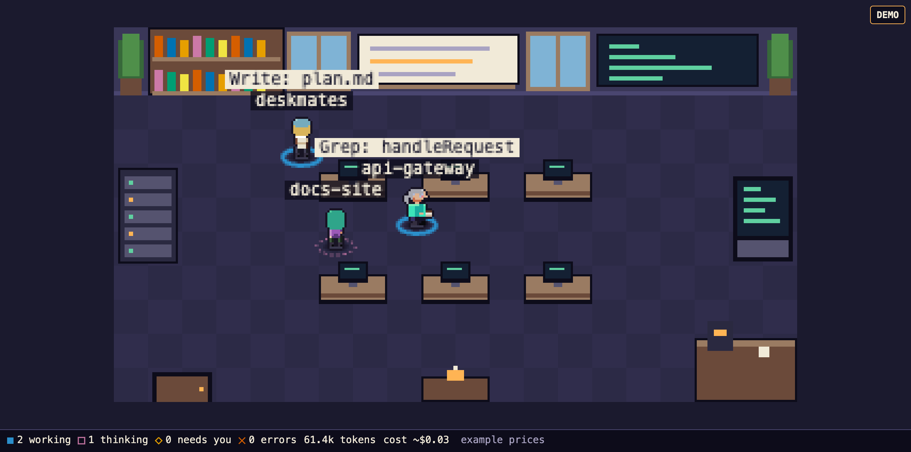

# deskmates

Your live Claude Code sessions, as a pixel-art office. Each session is a person at a desk; subagents show up as extra people. You can see at a glance who is working, thinking, waiting for you, or stuck, plus tokens and an estimated cost.



*The built-in demo (`/?demo=1`) with scripted example data.*

Status: v0.1, not yet published to npm. Build and run from this repo.

## Privacy first

- **Local only.** deskmates reads transcripts from `~/.claude/projects` on your machine and sends nothing anywhere. No telemetry, no network calls.
- **Read only.** v0.1 watches. It does not install hooks, edit your Claude Code settings, or change any session.
- The server binds `127.0.0.1` only. Every launch generates a fresh random token that is never written to disk or logged. It lives in the URL fragment (`#t=...`), which browsers do not send to the server.
- Transcript text is rendered as text, never as HTML, and raw transcript content is never stored or logged.

Details and the threat model: [docs/SECURITY.md](docs/SECURITY.md).

## Run it

Requires Node 20 or newer and pnpm for the initial install.

```bash
pnpm install
(cd packages/client && node build.mjs) && (cd apps/cli && node build.mjs)
node apps/cli/dist/deskmates.js
```

It prints a launch URL such as `http://127.0.0.1:7878/#t=...` and opens it in your browser. Flags:

| Flag | Meaning |
|---|---|
| `--port <n>` | Port (default 7878, `0` picks a free one) |
| `--no-open` | Do not open a browser; paste the printed link yourself |
| `--projects-dir <path>` | Transcript directory (default `~/.claude/projects`) |
| `--help`, `--version` | Usage and version |

With `--no-open` the token never appears in a process argument. Without it, the opener receives the full URL, so another local process of yours could briefly see it in `ps`. See [apps/cli/README.md](apps/cli/README.md).

Add `?demo=1` to the URL to see a scripted demo with example data instead of your sessions.

## What you see

- One character per active session, tagged with the project name; the current tool call appears next to them. Repeated subagents are numbered.
- Sessions that are idle or over the on-screen cap are hidden and counted (for example `+N idle` in the wide HUD).
- Status is never color alone: working (rotating dashes), thinking (pulsing dots), needs you (thick ring and bell), error (zigzag and `!`), done (check), idle (no ring).
- A status bar with counts, token totals and cost.

### Cost is an estimate

Costs are computed from token counts and a built-in price table (a snapshot dated 2026-10-18), labelled `~` and `est.` in the UI. Prices change and some cases (long-prompt tiers, 1-hour cache writes) are not modelled. To override, create `~/.deskmates/prices.json`; entries merge over the defaults per model. Check current pricing at <https://platform.claude.com/docs/en/about-claude/pricing>.

## Layout

| Path | Purpose |
|---|---|
| `packages/core` | Event types, reducer, selectors, price table |
| `packages/provider-claude` | Tolerant transcript parser (never throws on a bad line) |
| `packages/sprites` | Procedural sprite generator, all art generated in code |
| `packages/server` | Watcher, HTTP and WebSocket server, security checks |
| `packages/client` | Canvas renderer, HUD, demo |
| `apps/cli` | The `deskmates` command |

Design docs: [architecture](docs/ARCHITECTURE.md), [design](docs/DESIGN.md), [roadmap](docs/ROADMAP.md).

## Develop

Run in each package directory:

```bash
node node_modules/vitest/vitest.mjs run
node node_modules/typescript/bin/tsc -p . --noEmit
```

`node scripts/smoke-real.mjs` checks parsing against your real transcripts and prints counts only. `node scripts/bench.mjs` runs the 50-session benchmark.

## Roadmap

v0.2 adds approve/deny from the browser, gated on a separate capability, a real-browser DNS-rebinding harness and consented hook install. Replay, redacted export and other providers come after. See [docs/ROADMAP.md](docs/ROADMAP.md).

## License

MIT, see [LICENSE](LICENSE).
