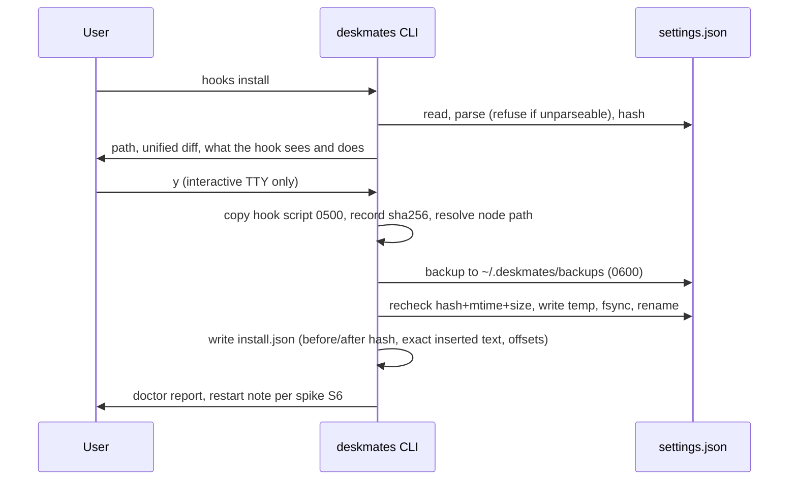
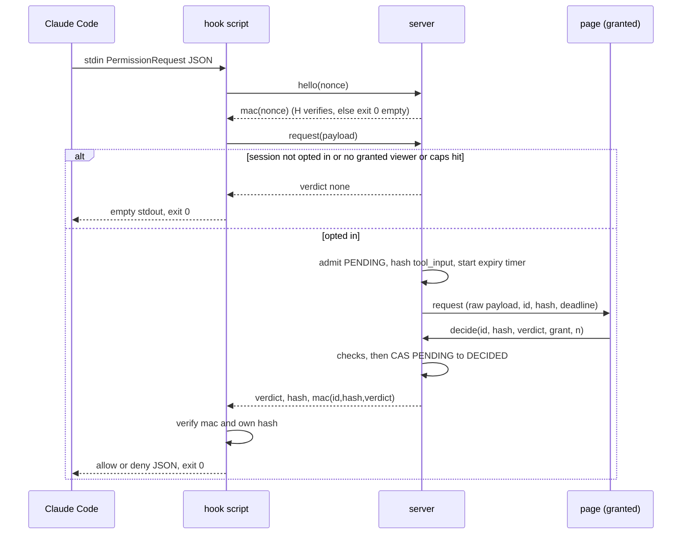
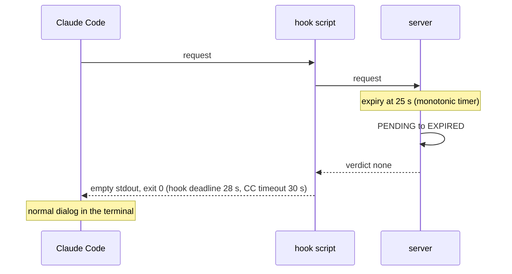
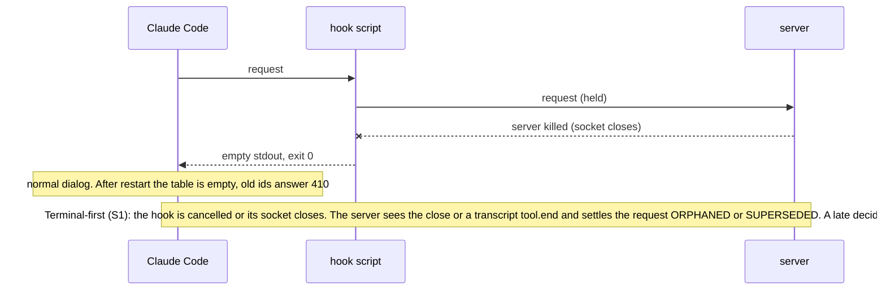
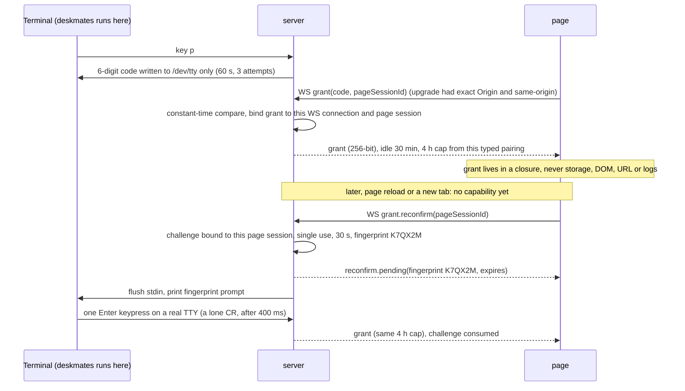

# deskmates v0.2 spec: control

Status: draft for owner review. Docs only: no code, nothing installed, nothing published. Method: spec-driven development (Specify, Plan, Tasks, with a gate between phases). Companion to `docs/v0.2/THREAT-MODEL.md` (46 threats, assumptions A1-A17) and `docs/SECURITY.md`.

Conventions in this file:

- Requirements are `R1..R86`. Threat ids from the threat model are written `TM:` plus the id, for example `TM:X1`, `TM:R3` (threat model "R3" is not requirement R3).
- `OWNER DECISION` marks anything CLAUDE.md says needs approval first (schema change, new dependency, hook install code, state-changing endpoint policy, publishing). Nothing marked so is decided here; each is an open question in section 14 with a recommendation.
- `SPIKE Sn` marks something that is not verified from official docs. It must be settled by a spike with a pass criterion (section 11) before the design that depends on it is built.

## 1. Goals and non-goals

### Goals

| # | Goal |
|---|---|
| G1 | Install and uninstall a Claude Code `PermissionRequest` hook with a shown diff, explicit consent, a backup, and a byte-identical uninstall. |
| G2 | Hook-based "Needs you": know exactly when Claude Code is about to ask, instead of guessing with the 8 s heuristic. |
| G3 | Approve or deny a request from the browser, per session, opt-in, single use, bound to the exact input shown. |
| G4 | Jump to the terminal that owns a session, only when that can be known; say "unknown" otherwise. |
| G5 | Never wedge or silently change a Claude Code session: every failure degrades to Claude Code's own dialog. |

### Non-goals (explicit)

| # | Non-goal | Why |
|---|---|---|
| N1 | No "always allow", "allow for this session", rule creation, or any persistent decision | One misread becomes standing code execution (threat model 3.9). |
| N2 | The hook never returns `updatedInput` or `updatedPermissions`, and never `interrupt` | `updatedInput` replaces the whole input; `updatedPermissions` persists rules. A test asserts the output schema (R1, R34). |
| N3 | No LAN, remote, team, tunnel or phone access | Separate product and threat model (`TM:6`). The server keeps refusing any non-loopback bind. |
| N4 | No replay, recorder, export, clips | v0.3 and v0.4. Raw `tool_input` never enters a `NormalizedEvent`, so replay cannot capture it later (R44). |
| N5 | No approving anything a permission rule denies | Claude Code evaluates deny, then ask, then allow; a hook allow does not override a deny rule (verified, section 3). We rely on it and contract-test it (R36). |
| N6 | No auto-approve policies, allowlists, timers that decide, or "approve all pending" | A decision is one human act on one request. |
| N7 | No claim that deskmates is a sandbox or a security boundary | Same-uid processes are out of reach (threat model R-A). Docs and UI say so. |
| N8 | No approve for any tool other than Bash, Edit, Write and WebFetch (OQ12 b); every other tool is terminal only | `TM:D4`. |
| N9 | No keystroke injection into terminals | Jump only focuses (`TM:J4`). |
| N10 | No Windows support in v0.2 unless the owner asks (OQ6) | Unix domain socket ingest, `ps`, AppleScript, tmux are Unix tools. |
| N11 | No automatic install (no postinstall, no install on first run) | `TM:I9`. |
| N12 | No change to the read-only v0.1 behavior for users who never install hooks | Passive mode keeps working exactly as before. |

## 2. Two adversaries

The design treats these separately, because the controls that stop one do nothing to the other.

| | A. Malicious web page | B. Prompt-injected model, or any other process of the same user |
|---|---|---|
| Where it runs | A tab or iframe in the user's browser | Same uid: it can run `curl`, read any user file, any env var, `ps` argv, scan loopback, edit settings |
| What it controls | Requests the browser will make; cannot set `Host`, `Origin`, `Sec-Fetch-*` honestly-forged values | Everything, including forged `Origin`, `Sec-Fetch-*`, `Host` headers, and the text of `tool_input` |
| Stopped by | Exact `Host`; present exact same-origin `Origin`; `Sec-Fetch-Site: same-origin` on every state-changing request; `frame-ancestors 'none'`; CSP and Trusted Types; user gesture and dwell in the UI; ingest listener not reachable from browsers | Against browser-originated decisions only: the browser grant must not exist on disk, in env, in argv, or in the launch URL; it is delivered out of band to the human (a pairing code printed on the terminal where deskmates runs) and then lives in page memory. Nothing stops this adversary from answering the hook through the ingest secret (same-uid ceiling below) |
| NOT stopped by | Nothing here can stop a page that is allowed to run script inside our origin (XSS): CSP, no HTML sinks, no third-party script are the defense | Header checks (forgeable), gestures (it never needs one), file modes (same uid reads them) |
| Residual | R-B: script inside our page | The same-uid ceiling, and RR1 (reading the deskmates terminal or driving the user's browser defeats pairing) |

### The same-uid ceiling

An agent or process running as the user, with even one allowed Bash call, can already: edit `~/.claude/settings.json` or `.claude/settings.local.json` (add an allow-all rule or its own hook), run `claude` itself, read `~/.deskmates/run/ingest.json`, replace `ingest.sock`, read the browser profile on disk, and signal the server. So against a same-uid code-execution adversary deskmates adds no capability and removes none. What deskmates must guarantee instead:

1. It does not lower the bar for the normal flow: Claude Code's own prompt is skipped only after a human act in a page protected as in column A (R29, R30).
2. It does not widen the blast radius. Installing a user-global hook reaches every project and every session, and sends every permission request to a local server (a takeover or a bug then affects all projects). Slice 1 is already a state change: it edits `settings.json`, adds `/api/exchange`, and runs a hook in every session it covers. This is why the install scope is an explicit choice (OQ7, R14), not a silent global default.

What each secret is, precisely:

| Secret | What it is | What it protects | What holding it means |
|---|---|---|---|
| Ingest secret (`ingest.json`, 0600) | Authenticates the hook peer to the server and the server to the hook (hello and verdict MACs) | Accidents, squatters without the file, other users | Anyone who reads it can answer the hook with allow or deny and take over the socket. This equals R-A and is accepted (RR7). It is on disk by necessity (the hook must read it) and is NOT presented as a protected decide capability |
| Pairing code and grant | A one-time terminal-printed code exchanged for a page-memory grant | Browser-originated decisions only: no web page and no process without the code can make the page-side decide path accept | A holder of the grant can decide through the server. Not on disk, env, argv or URL (R26) |
| Read token / nonce | Read access to office state / one-time bootstrap | Reading metadata | Cannot decide |

Consequences used throughout:

- The ingest secret and the grant are different secrets with different powers (R19, R26). Holding the ingest secret lets a process answer the hook (the same-uid ceiling) but gives no read access and no ability to decide through the server.
- A forged ingest request that goes through our server cannot approve a real Claude call: the verdict is delivered only on the forger's own connection. It can social-engineer the user ("Claude wants to run X"); mitigations in section 4.4. A forger who replaces the socket, and so answers the hook directly, is the ceiling above, detected but not prevented (R55, RR6, RR7).

## 3. Claude Code contract the design stands on

Sources: code.claude.com/docs/en/hooks, /permissions, /settings, /sub-agents, /headless. Verified rows come from the official docs; every other row is a spike.

| Fact | Status |
|---|---|
| `PermissionRequest` event exists. Input: `session_id`, `transcript_path`, `cwd`, `permission_mode`, `hook_event_name`, `tool_name`, `tool_input`, optional `mcp_server`, optional `permission_suggestions` | VERIFIED |
| No `tool_use_id`, no pid, tty or terminal field is documented. Requests are correlated by `session_id` + `tool_name` + canonical hash of `tool_input` | VERIFIED (absence); correlation quality SPIKE S7 |
| Output `hookSpecificOutput.hookEventName: "PermissionRequest"` + `decision.behavior: "allow" \| "deny"`. Allow may carry `updatedInput`, `updatedPermissions`; deny may carry `message`, `interrupt`. v0.2 emits only the bare shapes in R1 | VERIFIED |
| Exit 0 with JSON applies the decision. Exit 0 with no output leaves the normal permission flow. Exit 2 is not honored for this event. Other non-zero is a non-blocking error and the action proceeds, unless the hook has `onFailure: "block"`, which denies. deskmates never sets `onFailure` | VERIFIED |
| What "proceeds" means after a crash (the normal dialog still appears, never an implicit allow) | SPIKE S2 |
| Hook `timeout` is in seconds, default 600; on timeout the hook is cancelled and its output discarded | VERIFIED |
| Whether the terminal dialog is shown in parallel with a pending hook, or blocked until it returns; what happens if the user answers in the terminal first | SPIKE S1 (most important) |
| Rules evaluate deny, then ask, then allow. A hook allow does not override a matching deny rule. `PermissionRequest` runs only when Claude Code is about to ask (or would auto-deny); rule-decided calls skip it | VERIFIED. Contract test S11 still required |
| How several hooks' decisions combine for one event | SPIKE S3 |
| Hook types: command, http, mcp_tool, prompt, agent. http hooks POST the event JSON; header `$VAR` interpolation only for `allowedEnvVars`; non-2xx or connection failure is non-blocking. An http hook therefore cannot carry a per-run secret into an already-running Claude Code | VERIFIED. localhost allowed: SPIKE S12 (low priority) |
| Settings precedence managed > `--settings` > `.claude/settings.local.json` > `.claude/settings.json` > `~/.claude/settings.json`; hooks merge across levels; plugins and skill/agent frontmatter also define hooks; `disableAllHooks` exists | VERIFIED |
| Whether running sessions pick up hook edits; comments and trailing commas in settings; whether project hooks need a trust review | SPIKE S6 |
| Command hook shape: matcher semantics for `PermissionRequest`, run via a shell, cwd and env | SPIKE S5 |
| Hooks apply inside subagents; background subagent prompts surface in the main session naming the subagent. Whether the payload carries `agent_id` | VERIFIED (scope); `agent_id` SPIKE S8 |
| Hook firing under acceptEdits, auto, plan, bypassPermissions; headless behavior is documented as "no hook decision means deny" in sessions that cannot prompt | Modes SPIKE S8; headless VERIFIED |
| Command hooks have no controlling terminal. Documented env vars: `CLAUDE_PROJECT_DIR`, `CLAUDE_CODE_REMOTE`, `CLAUDE_CODE_BRIDGE_SESSION_ID`; no pid or tty | VERIFIED. Parent-chain pid: SPIKE S4 |
| Docs give no `tool_input` sanitization guidance and say rules are not a security boundary | VERIFIED. Treat `tool_input` as untrusted |

## 4. User flows and UX

### 4.1 Flows

| Flow | Steps | Notes |
|---|---|---|
| F1 Install | `deskmates hooks install` in a terminal. It prints the settings file path, a unified diff, what the hook can see and do, the uninstall command. Asks `Install? [y/N]` on a TTY. Writes backup, patches file, copies hook script, records `install.json`, runs doctor | No `--yes`. Non-TTY refuses. `--dry-run` prints the diff only. Running Claude Code sessions may need a restart (S6); the command says what S6 found |
| F2 Passive start | `deskmates` as today (v0.1 behavior). With a hook installed, the server also opens the ingest listener. Hook seen status per session appears after its first request | Without a hook: heuristic Needs-you, unchanged |
| F3 Needs-you from hook | Claude Code is about to ask. Hook posts the request. For a session without opt-in, the server replies "no decision" at once (Claude Code's dialog appears without waiting on us, assuming S1 shows the dialog is not blocked; the hook still adds Node start-up and one local round trip, budget p95 under 150 ms (S13), to every permission prompt in every session the hook covers, opted in or not) and the page shows the attention ring and queue entry with only the tool name | Raw input is not sent to connections without a grant (R44) |
| F4 Pair (first time this run) | User presses `p` in the terminal where deskmates runs. A 6-digit code appears on that terminal (60 s, 3 attempts). User types it into the page's pairing field. Page holds a grant in memory | The page shows "Controls: on until idle 30 min", "N controllers paired" and a "Lock" button; every grant prints a line on the terminal (R71). The 4 h cap runs from this typed pairing |
| F4b Re-confirm (page reload or another tab) | The new page has no capability. It shows "Press Enter in the terminal to confirm page K7QX2M". The terminal prints "Page K7QX2M wants to resume controls. Press Enter only if you just loaded or reloaded the deskmates page and it shows this code." User presses Enter once. The page gets a grant | Needs a real TTY on stdin; under tmux or screen, or when S17 marks the terminal injectable, the user retypes the code instead (R80, R81). Each tab needs its own confirm. Nothing is stored in the browser or on disk (R82) |
| F5 Opt in a session | In the page, on a session card: "Allow browser approvals for this session". A persistent banner on the card and in the panel says "Browser approval ON, session abc123, ~/proj, expires 30 min after last use" | Per session, never global. The terminal-side out-of-band step is pairing (F4); per-session opt-in is made in the page with the grant (OQ20 offers terminal-side opt-in instead). Off at start and after expiry, session end, lock, restart |
| F6 Request card | A request from an opted-in session with a granted viewer connected opens the card (section 4.2) | |
| F7 Decide | User waits out the dwell, reads, clicks Approve or Deny with the pointer, or Tabs to the button and activates it (section 4.3) | Result text says "sent to Claude Code", not "applied" (R46) |
| F8 Timeout | Countdown reaches zero. Card becomes "Expired. Answer in the terminal." Claude Code's own dialog is what the user sees | Never a default decision |
| F9 Terminal answered first | Card becomes "Already handled" and disables | Behavior depends on S1 |
| F10 Jump | "Jump to terminal" on a session card, enabled only when the pid and tty were verified (slice 3) | Otherwise the card says "terminal unknown: find it by session id and cwd" |
| F11 Uninstall | `deskmates hooks uninstall`. Shows the diff, asks, restores the exact bytes | |
| F12 Server crash | Hooks get a closed socket and exit 0 with no output. Claude Code asks in the terminal. On restart the table is empty; old ids answer 410 | |

### 4.2 The request card

All text comes from the hook payload, rendered with `textContent` only (R40).

| Element | Rule |
|---|---|
| Header | Session title (or short id), `cwd` (home as `~`) labelled "session directory: Bash keeps `cd` between calls, so the command may run elsewhere" (R77), git branch if known, agent (main, or "subagent: unknown" until S8), `permission_mode` from the payload, label "reported by hook" and the corroboration badge (R25) |
| Primary content, Bash | `command` verbatim in a numbered monospace block, wrapped. Escaping per R37 and R59. Every other key shown (R84); `description` in a separate box "written by the model, untrusted" |
| Primary content, Edit | Absolute realpath (with the as-given path when different), sensitive-target flag, full `old_string` and `new_string` side by side or stacked, `replace_all` (R84) |
| Primary content, Write | Same path rules; full `content` with byte length and line count; head and tail visible, show full, wrapping (R84) |
| Primary content, WebFetch | Raw URL and parsed scheme, userinfo, host (punycode and Unicode), port, path, query, fragment, each flagged when unusual; the `prompt`; a note that redirects are not shown (R85) |
| Primary content, every other tool | Pretty-printed full JSON plus `mcp_server` and tool name; terminal only, Approve disabled (R86) |
| All keys | Every key of `tool_input` is rendered, not only `command`. Per tool there is an allowlist of known keys (Bash: `command`, `description`, `timeout`, `run_in_background`; the real list comes from S15). A key outside the allowlist, or `dangerouslyDisableSandbox: true`, shows a red flag naming the key and disables Approve (R57) |
| Show full | Head and tail always visible, plus length and line count, in every tool's long fields. Over 2000 characters or 40 lines: Approve stays disabled until expanded and scrolled to the end. Over 16 KiB per field or 32 KiB in total: no Approve, "answer in the terminal"; nothing the Approve button covers is ever silently truncated (R86) |
| Hash | First 8 hex of the SHA-256 of canonical `tool_input` next to Approve |
| Countdown | Plain text "expires in 17 s" and a thin bar. No colors that escalate, no animation, no sound |
| Buttons | Deny first and focused. Approve is a different color, disabled until dwell elapses. Plain `<button>` elements |
| Dwell | Approve enables after 1500 ms from first display of that request (the server also enforces this from the time it sent the request, R33), and re-arms for 600 ms after any change of the displayed request, window focus, or visibility change (`TM:D6`) |
| Gesture | The page acts only on events with `isTrusted === true`. A script-made `button.click()` is ignored. This is a UI aid against redress, not a security boundary: injected script can still send the WS frame (threat model 3.2) |
| Hide details | A toggle blurs the card with CSS and disables Approve while on. It never rewrites the command (it would break D1) |
| Notifications | Off by default. When on, the text is exactly "A session needs you". No tool, command or path (R42) |

### 4.3 Keyboard

`TM:D6` says Enter and Space must not approve; WCAG 2.1.1 says every control must work from the keyboard. Resolution proposed (OQ11): no global shortcut and no default focus on Approve; a keyboard user reaches Approve with Tab, and Enter or Space on the focused Approve works only after dwell. Deny is first in tab order. Accessibility Auditor reviews this before slice 2 ships.

### 4.4 Mitigating forged requests (adversary B)

Ingest is a separate listener (R18) and the credential is readable by the model (R20), so a hostile process can create a request that looks real. Mitigations:

1. The card is labelled "reported by hook". Session, cwd and agent come from the payload and are shown as claims.
2. Corroboration is a badge, not a gate (R25, OQ10 option b). The server already tails the transcript; a request shows "seen in transcript" when the watcher has an open `tool_use` in the claimed session with the same tool name and canonical input hash (in memory only), otherwise "not seen in transcript". Approving a forged request only answers the forger and runs nothing, so gating on corroboration would hold the real feature hostage to S7 and to watcher latency for a harmless case. S7 stays an informational spike.
3. Decisions go only to the originating connection (R24), so a forged approve never reaches Claude Code.
4. Caps, rate limits and fairness (R22, R72) stop floods; the page never reorders under the cursor (R43) and a background arrival never re-arms the dwell of the card on screen.

## 5. Architecture and data flow

### 5.1 Components

```
Claude Code (user terminal)
   | stdin JSON / stdout JSON
   v
hook script  ~/.deskmates/hook/pr.mjs   (dependency-free, 0500)
   | HTTP over a Unix socket  ~/.deskmates/run/ingest.sock  (0700 dir)   [OQ5]
   v
+-------------- deskmates server (existing, 127.0.0.1) ---------------+
| ingest listener (new, no browser route)    request table (memory)   |
| transcript watcher -> corroboration index  state machine (CAS)      |
| browser listener: static, /api/status, /api/exchange, WebSocket     |
+----------------------------------|----------------------------------+
                                   | WS (read token; grant for control)
                                   v
                            browser page (grant in a closure)
terminal where deskmates runs: key `p` pairs, key `x` revokes, prints to /dev/tty
```

The ingest listener is a second listener so that no ingest route exists on the port a browser can reach. On a Unix socket, browsers cannot connect at all, which removes `TM:H1` and `TM:H6` (port squatting) by construction and replaces them with a socket-owner check. The TCP-loopback fallback (OQ5) adds the checks in R18 and R21.

### 5.2 Install



### 5.3 Request, decide



### 5.4 Timeout



### 5.5 Crash and terminal-first



### 5.6 Pairing and re-confirm



### 5.7 Hook timing

Three nested deadlines, shortest first, all configurable in the range 10-90 s (OQ8, pending S1):

| Timer | Default | Owner |
|---|---|---|
| Server expiry of a pending request | 25 s | Server, monotonic clock. What the countdown shows |
| Hook's own wall-clock deadline | 28 s | Hook script, from process start |
| `timeout` field written into settings | 30 s | Claude Code. Never the 600 s default |

Cost of waiting is paid only by opted-in sessions with a granted viewer connected. Every other request is answered "none" immediately, so installing the hook costs one local round trip (S13: p95 under 150 ms including Node start) and never holds a session.

## 6. Exact surface

### 6.1 Browser listener (127.0.0.1:PORT, existing)

Every route keeps the v0.1 checks: exactly one `Host` equal to `localhost:PORT` or `127.0.0.1:PORT`; no CORS headers; no cookies. `X` = additionally requires `Origin` present and exact, `Sec-Fetch-Site: same-origin`, `Content-Type: application/json` (this is stricter than v0.1, which allows a missing Origin and refuses only `cross-site`; v0.1 behavior stays for read-only routes).

| Route | Method | Auth | Purpose | Slice |
|---|---|---|---|---|
| `/` and static assets | GET, HEAD | Host only | Page shell (unchanged) | 0.1 |
| `/api/status` | GET | read token (Bearer) | Counts and reason codes. New fields: hook seen count, pairing state, rejected counters, no content | 0.1, extended in 1 |
| `/api/exchange` | POST | X, plus the one-time nonce in the body; no token. OWNER DECISION (OQ4: a state-changing route without the per-run token) | Exchange `{nonce}` for the read token. Nonce 128-bit, single use, 30 s, consumed on first lookup even if the rest is malformed; reuse prints a loud terminal line | 1 |
| WebSocket upgrade | GET | Host, Origin, read token as today. The connection is marked `verified` only if Origin is present and exact and `Sec-Fetch-Site` is `same-origin` | Same as v0.1 | 0.1, flag added in 1 |
| any other method or path | | | 405 or 404 as today | |

WebSocket client to server (new types are additive; v0.1 servers ignore unknown types, v0.1 clients never send them):

| Message | Fields | Auth | Effect |
|---|---|---|---|
| `resync` | none | read token (existing) | Unchanged |
| `grant` | `code`, `pageSessionId` | `verified` connection + 6-digit code (first pairing of the run only) | Returns `grant`; bound to this connection and page session |
| `grant.reconfirm` | `pageSessionId` | `verified` connection; a typed pairing already happened this run; rate limited | Creates a terminal re-confirm challenge (R79); no capability until Enter |
| `revoke` | none | grant | Drops the grant and this connection's opt-ins |
| `session.optin` | `sessionKey`, `on` | grant | Per-session opt-in on or off; 30 min idle expiry |
| `decide` | `requestId`, `inputHash`, `verdict` (allow or deny), `grant`, `n` (monotonic counter) | `verified` connection + grant + opted-in session. Read token alone: refused | Section 8 |
| `focus` | `sessionKey` | grant | Jump (slice 3), rate limit 1 per second |

WebSocket server to client (new, additive):

| Message | To | Content |
|---|---|---|
| `grant.ok` / `grant.fail` | requester | Grant and expiry, or a reason code only |
| `reconfirm.pending` | requester | Short fingerprint, expiry; the same fingerprint is printed in the terminal |
| `request` | granted connections only | `requestId`, `sessionKey`, display fields, the raw `tool_input` object, `inputHash`, `shownAt`, `deadline`, `transcriptSeen` (badge only), tool renderability flag |
| `request.state` | granted connections | `requestId`, state, reason code |
| `decide.result` | requester | `accepted`, `conflict` (409), `gone` (410), `refused` (403) or `bad` (400), reason code |
| `control.state` | all verified connections | pairing active or not, opted-in session keys, hook-seen per session. No content |

`tool_input` never travels to a connection without a grant and never appears in snapshots, events, `/api/status`, logs or audit (R44).

### 6.2 Ingest listener (new, separate)

Default transport: Unix socket `~/.deskmates/run/ingest.sock`, directory 0700, socket 0600, server checks the directory and socket are owned by the current uid and not group or world accessible at startup, and the hook checks the same before sending (OQ5). Fallback transport, only if the owner rejects the socket: loopback TCP on a separate port with the extra checks marked TCP.

| Route | Method | Auth | Body and reply |
|---|---|---|---|
| `/v1/hello` | POST | none (socket permissions, same-uid peers only); TCP: exact Host | Body `{nonce}` (128-bit). Reply `{mac}` = HMAC-SHA-256(ingestSecret, "hello" + nonce). The hook sends nothing else until it verifies this (R21) |
| `/v1/request` | POST | `X-Deskmates-Hook: <ingest secret>`, `Content-Type: application/json`, body at most 1 MiB, depth and key limits. TCP: reject any request carrying `Origin` or any `Sec-Fetch-*` header | Body `{v, hookPid?, requestNonce, payload}` (`requestNonce` is 128-bit, fresh per call) where `payload` is the fields of section 3 minus `permission_suggestions` (dropped on arrival). The reply is two newline-delimited JSON lines. Line 1, within 500 ms or the hook exits 0 (R60): `{ack: "held", requestId}` or `{ack: "none"}`. Line 2, only after `held`, when decided, expired or closed: `{requestId, verdict: "allow" \| "deny" \| "none", inputHash, mac}`, mac = HMAC(ingestSecret, requestId + requestNonce + inputHash + verdict) (R61). Closing the connection cancels |

The server owns the socket inode and watches it (R55, R68). This listener is not a browser-reachable HTTP surface: there is no `Host` or `Origin` on a Unix socket, so what authenticates a call is socket location and mode (0700 dir, 0600 socket, owner checked), the ingest secret, and the server's MAC. SECURITY.md's non-negotiable (a per-run secret plus Host and Origin for state-changing HTTP endpoints) is unaffected for the browser listener and must be amended to say it applies to browser-reachable endpoints and that non-browser listeners authenticate as above (OQ4c, section 17). The ingest secret authenticates the hook peer and lets its holder answer the hook (section 2); it is not a decide capability. It grants only these two routes. It cannot read state or decide (R19). It lives in `~/.deskmates/run/ingest.json` (0600, dir 0700), is written atomically on server start, rotated every start, and never appears in argv, env, URLs, settings, backups or logs (R20).

## 7. Events and schema changes

Current `NormalizedEvent` (`packages/core/src/events.ts`) already has `attention{toolUseId, source:'heuristic'|'hook', requestId?}` and `attention.resolved{toolUseId, decision?}`. What v0.2 needs beyond that:

| Id | Need | Proposal | Status |
|---|---|---|---|
| E1 | `attention` requires `toolUseId`, but the hook payload has none. The reducer keeps ONE attention slot per agent and clears it on `tool.end` or `attention.resolved` only when `toolUseId` matches (`packages/core/src/reduce.ts`); the server ticker raises the heuristic `attention` with the real id for any open tool not already flagged (`packages/server/src/ticker.ts`). A synthetic `hook:<requestId>` id would never be cleared by `tool.end`, the agent would stick in "waiting", the ticker would then overwrite the slot with the real id (flip-flop), and a second pending request would overwrite the first | Keep it additive and put the correlation in the server, not the schema. Rules (E1-rules below) | OWNER DECISION (OQ1) with three options |
| E2 | `attention.resolved` only says allow, deny or nothing; the UI needs expired, superseded, orphaned, terminal-answered | Add optional `outcome?: 'allow' \| 'deny' \| 'expired' \| 'superseded' \| 'orphaned' \| 'terminal'`. Additive; old consumers ignore it | OWNER DECISION (OQ2). Alternative: no change, show "resolved" only |
| E3 | Per-session "hook seen / mode skips prompts" badge (`TM:D9`) | New kind `session.hook { state: 'seen' \| 'stale'; permissionMode?: string }`. Additive; reducer stores it on the session | OWNER DECISION (OQ3). Alternative: carry it only on the `control.state` WS message, outside the reducer |
| E4 | Raw request content and decisions | Not events. New WS message types in section 6.1; protocol `v` stays 1 because the additions are ignorable | OWNER DECISION (OQ4b): confirm the additive protocol change. Raw `tool_input` must never be put in a `NormalizedEvent`, so the v0.3 recorder cannot capture it |

E1 rules (option A, recommended, no type change):

1. The server correlates a hook request to an open tool in that agent's `openTools` by tool name plus canonical input hash (the ticker and watcher already hold open tool ids; hashes are kept in memory only). On a match it publishes `attention{toolUseId: <real id>, source: 'hook', requestId}`. The existing `tool.end` and `attention.resolved` logic then clears it with no reducer change.
2. No match yet (the transcript line may lag the hook): the server waits up to 10 s for a matching `tool.start`, then publishes; if none arrives it publishes no attention and the request lives on the control channel only. The card and notification do not depend on it.
3. Heuristic suppression: while a session's hook-seen state is fresh, the ticker does not raise heuristic attention for it. That removes the flip-flop.
4. Several pending requests for one agent: the reducer slot holds the oldest; the others exist only in the server's control table. When the slot's request settles, the server publishes attention for the next pending one.
5. When `attention.resolved` fires: on DECIDED (with `decision`) and on SUPERSEDED (the terminal answered). On EXPIRED or ORPHANED the call is still waiting for the user in the terminal, so attention stays (its `source` is not changed) until `tool.end` clears it; E2's `outcome` is only informational.

Option B: change the reducer to hold a per-agent list of attentions keyed by `requestId` (a state change in `core`, a selector change in the client, replay-visible). Option C: synthetic id plus a reducer rule that clears synthetic attention on the next `tool.start`, `tool.end` or `attention.resolved` for that agent (core change, and loses precision when parallel tools run). Trade-off: A keeps `core` untouched but depends on S7 for precision and on the server holding open-tool hashes; B is the most faithful and the most invasive.

No existing field is renamed or removed. If the owner rejects E1-E3 the feature still works with the alternatives in the table; the cost is less precise UI states.

## 8. Request state machine

Entries live in memory only, keyed by `requestId` (128-bit random, never reused). Admission creates an entry only when: the session is opted in, at least one granted viewer connection exists, per-session pending is under 5 and global under 20, rate limit not exceeded, tool has a renderer (else the request is shown read-only and answered "none"). Otherwise the hook gets `none` at once and no entry exists (a lightweight "observed" attention is still emitted with no payload kept beyond the hash).

### 8.1 States and transitions

| From | Event | Guard | To | Side effects | Caller sees |
|---|---|---|---|---|---|
| (none) | ingest request | admission above | PENDING | Hash canonical `tool_input`; store payload in memory; start monotonic expiry timer; push `request` to granted connections | Hook waits |
| PENDING | `decide` | All of: verified connection, valid grant bound to this connection, session opted in, `requestId` and `inputHash` match the entry, counter strictly greater than last, server dwell elapsed (R33) | DECIDED(allow or deny) | CAS in one synchronous step; write MAC'd verdict to the hook socket; audit; push `request.state` | `accepted` |
| PENDING | `decide` failing any guard other than state | | PENDING | Count and audit the refusal reason; no change | `refused` 403, `bad` 400 (id or hash mismatch, dwell) |
| PENDING | expiry timer | | EXPIRED | Reply `none` to hook; push state | Hook exits 0 empty |
| PENDING | opt-in revoked, grant revoked with no other granted viewer, or lock | | EXPIRED (reason) | Reply `none` immediately so the terminal dialog is not held | |
| PENDING | transcript shows the correlated call finished or newer same-agent request (only if S1/S8 show prompts are serialized per agent) | | SUPERSEDED | Reply `none`; push state | `gone` 410 on later decide |
| PENDING | hook socket closed or errored, heartbeat silent for more than 6 s, hook's parent changed (R74), session ended, server shutdown | no transcript evidence of terminal answer | ORPHANED | Drop payload; push state | `gone` 410 |
| DECIDED | verdict write fails | | DECIDED, flagged undelivered | Audit "undelivered"; UI says "could not be delivered, check the terminal" | |
| any terminal state | any `decide` | | unchanged | None | `conflict` 409 if DECIDED, `gone` 410 otherwise |
| any terminal state | 60 s after settle | | removed | Drop payload at settle time; keep only id and state tombstone for 60 s | unknown id answers 410 |

The payload (`tool_input`) is dropped from memory when the entry leaves PENDING. Compare-and-set is a single synchronous function with no `await` between reading and writing `state`; Node's single thread makes it atomic, and a test hammers it (section 10.4).

### 8.2 Binding a decision to what was shown

- `inputHash` = SHA-256 over canonical JSON of `tool_input`: UTF-8, object keys sorted by Unicode code point (an explicit comparator; JavaScript's default `sort()` orders by UTF-16 code units and puts astral-plane keys wrong), no whitespace, strings as parsed, numbers as `JSON.stringify` prints them. One implementation in `core`, a byte-for-byte copy inside the hook script, shared test vectors including astral-plane keys. Inputs the canonicalization cannot represent unambiguously are unsupported and answered `none` (R66): unsafe integers, duplicate keys (detected by a strict tokenizer on the raw text, since `JSON.parse` hides them), lone surrogates, and keys named `__proto__`.
- The page computes the hash itself (Web Crypto, available because `127.0.0.1` is a potentially trustworthy origin) over the same object it renders, and sends it. The server compares with its own hash of the stored payload. The hook recomputes from its stdin and checks the MAC (R6), so an allow that was bound to some other input prints nothing.
- The decision names the request id; there is no "current request", no position-based decide, no auto-advance of the selection when one resolves (R43).

### 8.3 Race cases

| # | Race | Outcome | Test |
|---|---|---|---|
| 1 | Decide and expiry timer in the same tick | Whichever handler runs first wins; the other sees a terminal state. Decide first gives DECIDED; expiry first gives 410 | Fake clock, both orders |
| 2 | Double click or two tabs deciding | First CAS wins; second gets 409 and is audited as a duplicate | 50 decides over 5 connections, exactly one accepted |
| 3 | Decide with wrong hash or for another request id | `bad`, state unchanged | Table of mismatches |
| 4 | Page shows B but a click carries A (request swapped under the cursor) | Decision for A refused (the page sends what was displayed); re-arm window ignores clicks within 600 ms of a swap | Synthetic click 100 ms after swap |
| 5 | Hook socket closes at the same time as a decide | Decide first: DECIDED then undelivered. Close first: ORPHANED, 410 | Interleaving test |
| 6 | Terminal answered first | Per S1: hook cancelled or socket closed gives ORPHANED; transcript evidence gives SUPERSEDED. A decide that wins the CAS before the server notices becomes undelivered | Stub terminal, S1 behavior |
| 7 | Hook cancelled by Claude Code's own timeout while pending | Ordering 25 < 28 < 30 s prevents it; if forced, socket close gives ORPHANED | Black-hole test with shrunk timers |
| 8 | Server restarts mid-request | Hook exits 0 empty; new table is empty; old id answers 410 | kill -9 mid-request with stub Claude Code |
| 9 | Two pending requests in one session or agent | Independent entries decided by id only; the reducer attention slot holds the oldest and the server re-publishes for the next on settle (section 7 E1 rules) | Two requests, decide each |
| 10 | Opt-in or grant revoked while pending | EXPIRED at once, hook released | Revoke during pending |
| 11 | Verdict delivered but Claude Code ignored it (already timed out) | Unknowable from our side. UI says "sent", never "applied" | Documented; audit shows delivered yes/no only |
| 12 | Forged request reuses a real session's id | Badge "not seen in transcript"; a decision returns only to the forger and runs nothing | Forger harness |

## 9. Fail-open design

Principle: any deskmates failure becomes Claude Code's own prompt. Never an implicit allow, never a silent deny, never a wedged session.

Hook command written to settings (one line, marker as a trailing comment, paths single-quoted; install refuses a path containing a single quote):

```
[ -x '<node>' ] && [ -r '<script>' ] && exec '<node>' '<script>'; exit 0  # deskmates:v1
```

A missing script or node ends the shell with exit 0. When the guards pass, `exec` replaces the shell with Node, so if Claude Code kills the hook it kills the process that holds the socket (a plain `node ...; exit 0` would leave Node orphaned when only the shell dies). The script wraps its whole body in try/catch and `uncaughtException` handlers and exits 0; only a fatal Node failure (out of memory, a signal) can produce a non-zero exit, which the docs call a non-blocking error (S2 verifies the dialog still appears). The script prints only after it has the final answer, in one write. As a second guard the script exits when its parent pid changes and sends a heartbeat line every 2 s while held (R74). Exact shell semantics, kill behavior and matcher form: SPIKES S1, S5.

| Failure | Hook behavior | User sees |
|---|---|---|
| Server not running, socket missing or wrong owner | No retry, exit 0 empty within 500 ms | Normal dialog |
| Hello not verified (squatter, wrong MAC) | Send nothing, exit 0 empty | Normal dialog |
| Server slow, hung accept, slow-drip reply | Hook deadline 28 s total, connect 500 ms, exit 0 empty | Normal dialog after at most the wait |
| Server process hung or stopped (the kernel still accepts the Unix connection from its backlog) | No ack line within 500 ms: exit 0 empty (R60) | Normal dialog after about 0.5 s, not 28 s |
| Garbage reply, wrong request id echo, wrong MAC, hash mismatch | Exit 0 empty | Normal dialog |
| Unsupported input (unsafe integer, duplicate key, lone surrogate, `__proto__` key) | Send nothing, exit 0 empty (R66) | Normal dialog |
| Ingest socket replaced or script changed (R55, R63) | Server disables control and alarms on the terminal; hooks that reach a different listener cannot be stopped (RR6) | Normal dialog from the server's side |
| stdin over 1 MiB or invalid JSON | Send nothing, exit 0 empty | Normal dialog |
| Session not opted in, no granted viewer, caps hit, unsupported tool | Server replies `none` at once | Normal dialog, no delay |
| Decide mode refused because the hook hash differs from the recorded one | Server refuses control (closed for approve, not for the session) and says so; hook still replies `none` | Normal dialog |
| Node missing from recorded path | Guard exits 0 | Normal dialog |
| Hook killed by Claude Code (timeout or terminal-first) | Nothing to do. The server treats a closed or silent socket (no heartbeat for 6 s) as ORPHANED. VERIFIED by S1 (2026-10-19, `spikes/S1.md`): Claude Code sends SIGTERM to the hook, 87 to 131 ms after a terminal answer and 9.5 to 9.9 s into a 10 s timeout; in the exec form the hook is a direct child and stops within 0.25 s; the plain `sh -c` form also died (at most 0.83 s) | Normal dialog (answerable 54 to 94 ms after a key press while the hook still waits) |

Never: `onFailure: "block"`, exit 2, non-zero exit, reading config from `cwd`, spawning processes, writing files (R2, R5).

## 10. Install, uninstall, doctor

### 10.1 Which file

| Scope | Default | Notes |
|---|---|---|
| User `~/.claude/settings.json` | No default; only after an explicit "all projects" confirmation (OQ7 = ask each time, suggest project-local; R14) | One install then covers all projects, but it also reaches every project and every session, so a takeover or bug affects all of them. Sessions without opt-in cost one round trip |
| Project local `.claude/settings.local.json` | `--scope local` | Untracked by convention; refuse if git tracks it |
| Project `.claude/settings.json` | Refused unless `--scope project --i-know-this-is-tracked` | A committed absolute path ships to teammates (`TM:I5`) |
| Managed settings | Never touched | Reported by doctor |

### 10.2 Rules

| Concern | Requirement |
|---|---|
| Parse | Strict JSON unless S6 shows comments and trailing commas are valid, in which case a tolerant tokenizer. Unparseable: refuse, change nothing |
| Edit | Minimal text patch: insert one whole matcher-group entry (or a whole `hooks` or `PermissionRequest` member when absent), matching existing indentation, newline style and trailing-comma style. No re-serialization, no key reordering, no touching foreign entries |
| Consent | Unified diff plus path, interactive TTY only, no `--yes`; `--dry-run` writes nothing |
| Backup | `~/.deskmates/backups/<UTC timestamp>-<scope>-settings.json`, mode 0600, last 10 kept. Settings files can hold secrets in `env`; the backup is never read by the server |
| Atomic write | Temp file in the same directory, fsync, rename; edit the symlink target, not the link; keep mode; re-read and compare hash, mtime and size immediately before rename and abort with no change on mismatch |
| Marker | Command contains `deskmates:v1`. Uninstall removes an entry only if marker and the exact recorded command both match, so a lookalike or a repo-planted marker is left alone |
| Record | `~/.deskmates/install.json` (0600): scope, file path, hash before, hash after, exact inserted text and its anchor context, script sha256, node path, install time, Claude Code version seen |
| Byte-identical uninstall | If the file's hash equals the recorded "after" hash, remove exactly the inserted text; the result equals the backup bytes. If the user changed the file since, remove the marked entry by text match, show the diff, ask consent, and keep their edits |
| Script | Shipped inside the package, copied (not downloaded), dependency-free Node built-ins, a few hundred lines, `~/.deskmates/hook/` 0700, script 0500, sha256 recorded; server recomputes at startup and at every control enable and refuses control on mismatch (R16) |
| Uninstall also | Removes script and run files unless another scope still references them; leaves backups; prints that running sessions may keep calling the hook until restart if S6 says so |
| Duplicate keys | Refuse if any level the patch touches (`hooks`, `PermissionRequest`, the file root) has a duplicate key, because a last-wins parser could shadow the text we insert (R64) |
| Tracked check | The git-tracked test follows symlinks to the real target file (R64) |
| Backups | Backups hold the user's `env` secrets: dir 0700, files 0600; uninstall offers to delete them (R64) |
| Credentials | No credential ever appears in settings (command hook only; R20) |

### 10.3 `deskmates doctor` (read-only)

Checks and prints: settings entry present with marker and exact path, per scope; script exists, mode, hash equals recorded; recorded node path executable; run directory modes and socket ownership; server reachable (hello verifies); every other `PermissionRequest` hook in any layer (user, local, project, plugins, managed) with a warning that it may decide too (`TM:I6`); any `disableAllHooks`; managed settings present; Claude Code version against the tested range (refuse control on unknown versions, threat model R-G); leftovers after uninstall; hook-seen per live session if the server is up. It never claims "deskmates gates this".

## 11. Requirements

Each MUST is testable. Test column names the test in section 12.

| ID | Requirement | Threats | Test |
|---|---|---|---|
| R1 | The hook prints exactly one of three shapes: nothing; `{"hookSpecificOutput":{"hookEventName":"PermissionRequest","decision":{"behavior":"allow"}}}`; the same with `behavior:"deny"` and a fixed neutral `message`. No other keys, ever | TM:R1, TM:R5 | T-hook-golden |
| R2 | The hook exits 0 on every path, stdout empty on every failure path, and no deskmates entry ever sets `onFailure` | TM:R3 | T-hook-failopen |
| R3 | (Also see R60.) Server expiry 25 s, hook deadline 28 s, settings `timeout` 30 s (configurable 10-90 s, ordering enforced); connect timeout 500 ms; `timeout` is never the 600 s default | TM:R3, TM:X5 | T-timing |
| R4 | A request from a session without opt-in, without a granted viewer, over a cap, or for an unsupported tool is answered `none` immediately | TM:X8, TM:H5 | T-admission |
| R5 | The hook reads no config from `cwd` or project files, spawns no process, writes no file, uses no dependency | TM:I9 (3.8) | T-hook-static |
| R6 | The hook prints allow or deny only after verifying the MAC over request id, its own fresh request nonce, its own input hash and the verdict (see R61) | TM:R1, TM:R2, TM:H6 | T-hook-mac |
| R7 | Hook stdin over 1 MiB, invalid JSON, or missing fields: send nothing, exit 0 empty | TM:H4 | T-hook-failopen |
| R8 | Install requires an interactive TTY and a shown unified diff and path; no `--yes`; `--dry-run` writes nothing; no postinstall script exists | TM:I1, TM:I9 | T-install-consent |
| R9 | Timestamped backup, mode 0600, last 10 kept, written before any change | TM:I1 | T-install-backup |
| R10 | Install edits by minimal text patch, preserves foreign hooks, formatting, comments and newline style; refuses an unparseable file | TM:I1 | T-install-fixtures |
| R11 | Write is atomic (temp, fsync, rename), preserves symlinks and mode, and aborts with no change if hash, mtime or size changed since read | TM:I3 | T-install-race |
| R12 | Uninstall removes only entries with the marker and the exact recorded command; with an unchanged file the result is byte-identical to the backup; with a changed file it shows a diff, asks, and keeps user edits | TM:I2, TM:I5 | T-uninstall-bytes |
| R13 | The command is self-healing: missing script or node exits 0 within 100 ms; when the guards pass it `exec`s node so a kill reaches the process holding the socket | TM:I2 | T-selfheal |
| R14 | There is no silent global default: the installer asks for the scope and suggests project-local; user-global needs an explicit "all projects" confirmation that states the wider blast radius; a git-tracked project file needs an extra explicit flag; managed settings are never written | TM:I5 | T-install-scope |
| R15 | `doctor` and the install preview list every other `PermissionRequest` hook found in any layer and `disableAllHooks`; the UI never says deskmates "gates" an action | TM:I6 | T-doctor |
| R16 | Hook script ships in the package, is copied, dir 0700, file 0500, sha256 recorded; the server refuses control when the hash differs, checked at startup, at control enable and on every admission (R63) | TM:I9 | T-script-hash |
| R17 | Hook-seen status per session comes from actual ingests, never from settings alone; expires to stale | TM:I4, TM:D9 | T-hookseen |
| R18 | The ingest listener is not reachable from a browser: Unix socket, or on the TCP fallback a separate port that rejects any request with `Origin` or `Sec-Fetch-*` and enforces Host and JSON content type | TM:H1 | T-ingest-browser, T-rebind |
| R19 | The ingest credential is a different secret from the read token and the browser grant; it grants only `/v1/hello` and `/v1/request`, cannot read state, and cannot make a browser-originated decide succeed; the read token and grant cannot ingest. It is a hook-peer authenticator whose holder can answer the hook (the same-uid ceiling, RR7), not a decide capability | TM:H2, TM:X3 | T-capabilities |
| R20 | The ingest secret lives only in a 0600 file in a 0700 dir, written atomically each server start; never in argv, env, URL, settings, backups or logs | TM:H3, TM:I8 | T-secret-scan |
| R21 | The server proves identity (HMAC of a hook nonce) before the hook sends a payload; on the socket the hook also checks owner and mode. This stops squatters that lack `ingest.json`; it does not stop a same-uid process that holds it (RR6, RR7) | TM:H6 | T-hook-squatter |
| R22 | Body at most 1 MiB, depth and key limits, parser never throws out of a handler, pending caps 5 per session and 20 global, per-second rate limit; over-limit requests are answered `none` | TM:H4, TM:H5 | T-ingest-fuzz, T-flood |
| R23 | `tool_input` is held in memory only, dropped when the request leaves PENDING, never written to disk, logs, audit, cache or status | TM:H7 | T-secret-scan |
| R24 | A verdict is written only to the connection that created that request | TM:R4, TM:H2 | T-cross-delivery |
| R25 | Requests are labelled "reported by hook" and carry a badge "seen in transcript" or "not seen in transcript" from an open transcript `tool_use` with the same session, tool and canonical hash, read only per R62. The badge is informational and never gates Approve or Deny | TM:H2, TM:D8 | T-corroboration, T-forger |
| R26 | No browser-decide capability (pairing code, grant) exists on disk, in env, in argv, or in any URL, at any time. The ingest secret is on disk by necessity and is covered by R19, R20 and the same-uid ceiling | TM:X3 | T-secret-scan |
| R27 | First pairing in a run: code printed to `/dev/tty` only (refuse to pair if no TTY), 6 digits from a CSPRNG, valid 60 s, single use (a successful grant invalidates it, so a second tab cannot reuse it), 3 failed attempts per connection counted first and 12 across all connections as a hard cap, constant-time compare; when failures burned the code the terminal says so and a new code must be requested (R58). Later page loads use the re-confirm of R79-R83 instead of a new typed code | TM:X7, TM:X10 | T-pairing |
| R28 | Grant: 256-bit, bound to one WS connection and one page session id, memory only, idle expiry 30 min, absolute cap 4 h counted from the typed pairing (a re-confirm does not extend it), revocable from page and terminal, void on close, reload or server restart | TM:X9 | T-grant |
| R29 | `decide` and `focus` require exact Host, present exact Origin, `Sec-Fetch-Site: same-origin` on the upgrade, a `verified` connection and a valid grant. The read token with perfect headers is refused | TM:X1, TM:X3, TM:X7 | T-decide-auth, T-rebind |
| R30 | Control is off at start; opt-in is per session, grant-gated, shown by a persistent banner, expires after 30 min idle, on session end, lock and restart | TM:X8 | T-optin |
| R31 | A decision binds `requestId`, `inputHash`, verdict and a strictly increasing counter; any mismatch is refused without consuming the request | TM:X2, TM:X9 | T-bind |
| R32 | Transitions follow section 8.1; compare-and-set in one synchronous step; 409 for decided, 410 for expired, superseded, orphaned or unknown | TM:X4, TM:X5, TM:X6, TM:D10 | T-state-property, T-race |
| R33 | Approve is refused by the server unless 1500 ms passed since it sent that request to that connection; the page also enforces dwell and the 600 ms re-arm | TM:D6 | T-dwell |
| R34 | No "always allow", no persistent decision, no `updatedInput`, no `updatedPermissions`, no `interrupt` in UI, protocol, server or hook; a schema test asserts the hook output set | TM:R1 (3.9) | T-hook-golden, T-protocol-schema |
| R35 | Deny sends a fixed neutral message and no `interrupt` | TM:R5 | T-hook-golden |
| R36 | A call denied by a permission rule stays denied when the browser allows; a call the user's `ask` rule would ask about is allowed only by an explicit allow | TM:I7 | T-contract-precedence (S11) |
| R37 | The card renders raw payload fields as primary text, escapes visibly per R59 (at least every control, bidi, zero-width, tag, variation-selector and ANSI character), shows a non-ASCII badge with codepoints, numbers lines, and labels `description` as untrusted | TM:D1, TM:D2 | T-render-corpus |
| R38 | Head and tail always shown with length and line count; over 2000 characters or 40 lines Approve needs expand and scroll to end; the 16 KiB and 32 KiB caps of R86 apply | TM:D3 | T-render-length |
| R39 | Approve exists only for Bash, Edit, Write and WebFetch, each with its complete renderer (R84, R85); everything else is terminal only (R86) | TM:D4 | T-render-tools |
| R40 | No HTML sinks (lint fails CI), no inline script or style, strict CSP plus `require-trusted-types-for 'script'`, `frame-ancestors 'none'` and `X-Frame-Options: DENY` on every page; text via `textContent` | TM:D5, TM:D6 | T-xss, T-csp, T-iframe |
| R41 | No autofocus on Approve; only trusted click events count; keyboard activation per section 4.3; no global shortcut | TM:D6 | T-dwell, T-a11y |
| R42 | OS notifications say only that a session needs you; "hide details" blurs and disables Approve | TM:D7 | T-notify |
| R43 | Each card shows session title or short id, cwd, branch, agent and terminal identity when known; same-cwd sessions are disambiguated; requests are never merged or reordered under the cursor | TM:D8 | T-multisession |
| R44 | Raw `tool_input` goes only to connections holding a grant; never into a `NormalizedEvent`, snapshot, `/api/status`, audit, log or any file | TM:H7, TM:D5 | T-secret-scan |
| R45 | Per-session badge shows hook seen or not seen and the reported `permission_mode`; docs and UI state deskmates is not a sandbox | TM:D9 | T-badge |
| R46 | The page drops or disables a card on hook close, session end, expiry or supersede; result text says "sent", not "applied" | TM:D10 | T-ghost |
| R47 | The launch URL carries only a one-time 128-bit nonce valid 30 s; `/api/exchange` follows section 6.1; the token never appears in a URL or `ps`; reuse prints a terminal warning | TM:X10 (3.3) | T-nonce |
| R48 | Jump is offered only when the hook-reported pid is alive, owned by the user, and resolves to a tty that the OS tool maps to a window; otherwise "unknown"; never guessed from cwd | TM:J1 | T-jump-identity |
| R49 | Jump uses `execFile` with argument vectors and fixed scripts; tty must match `^/dev/ttys?[0-9]+$` and pid is an integer; titles, cwd and any model-controlled text never reach a script | TM:J2 | T-jump-inject |
| R50 | Jump needs a grant and the R29 header rules, and is limited to 1 per second | TM:J3 | T-jump-auth |
| R51 | Jump never sends keystrokes; the first use explains the macOS Automation prompt; refusal turns the feature off | TM:J4, TM:J5 | T-jump-nokeys |
| R52 | Audit log `~/.deskmates/audit.jsonl` 0600, append only, 5 MB x 3 rotation, allowlisted fields (time, request id, short session id, tool name, outcome, connection id, latency, delivered); never input text, paths from input, any hash or hash prefix of the input (a prefix lets someone confirm a guessable command), secrets, grant, nonce, ingest secret | TM:X9 (3.10) | T-audit |
| R53 | `/api/status` and the terminal count refusals by reason (bad host, bad origin, fetch-site, grant, nonce reuse, pairing failure) | TM:X10 | T-status |
| R54 | A real-browser rebinding harness (section 12.1) runs on every PR for Chromium and Firefox with a positive control and a mutation check before slice 2 merges | TM:X1, TM:H1, TM:D6 | T-rebind |
| R55 | The server holds the ingest socket inode it created, calls `lstat` on it every 1 s and before writing each verdict; if the inode or owner changed or the socket vanished, it disables control, drops pending requests and prints an alarm on `/dev/tty`. This detects takeover; it cannot prevent a replacement listener from answering hooks (RR6) | TM:H8 | T-socket-takeover |
| R56 | The launch URL and the pairing code are written only to `/dev/tty`, never to stdout, stderr or logs. Control (pairing) is refused when `TMUX` or `STY` is set or stdout is not a TTY, unless the owner passes an explicit flag (OQ19). This is a change from v0.1, which prints the URL on stdout | TM:X11 | T-tty-only |
| R57 | The card renders every key of `tool_input` for every tool (allowlists: Bash `command`, `description`, `timeout`, `run_in_background`; Edit `file_path`, `old_string`, `new_string`, `replace_all`; Write `file_path`, `content`; WebFetch `url`, `prompt`; all confirmed by S15). Any key outside the per-tool allowlist, or `dangerouslyDisableSandbox` true, shows a red flag and disables Approve; the allowlist comes from spike S15 | TM:D11 | T-unknown-keys |
| R58 | First-pairing code lifecycle per R27: single use, per-connection attempt budget first, global cap, burned-code notice on the terminal | TM:X12 | T-pairing |
| R59 | The renderer escapes every code point outside printable ASCII (including NBSP, U+3000, U+2028/2029, U+2800, U+3164, all other Zs, Zl, Zp, Cf, and combining marks) unless it sits in an allowlisted script run the user can see labelled; lines wrap, there is no horizontal scroll or clipping that hides text | TM:D2 | T-render-corpus |
| R60 | The server acks every request with `held` or `none` within 500 ms of connect; the hook exits 0 empty if no ack line arrives in 500 ms, independent of the connect timeout | TM:R7 | T-sigstop |
| R61 | The verdict MAC also covers a fresh per-request nonce chosen by the hook, so a captured allow cannot be replayed to another request | TM:R6 | T-mac-replay |
| R62 | Corroboration reads only transcripts the watcher discovered under the Claude projects root. The payload's `transcript_path` is never opened; it is only compared to known paths | TM:H11 | T-transcript-path |
| R63 | On every admission the server rechecks the hook script hash, inode and mtime, and scans the payload `cwd`'s `.claude/settings.json` and `.claude/settings.local.json` (those two names only, realpath inside `cwd`, size cap, treated as data) for any foreign `PermissionRequest` hook; if one is found, Approve is disabled and a banner names the file. Hooks from plugins and managed settings cannot be scanned this way; doctor lists what it can | TM:I10, TM:I6 | T-foreign-hook-scan |
| R64 | The installer refuses when a duplicate key exists at any level it touches, follows symlinks to the real target for the git-tracked check, writes backups 0600 in a 0700 dir, and uninstall offers to delete them | TM:I11, TM:I5 | T-install-fixtures |
| R65 | Playwright (a new dependency, not in any package.json today) is pinned exactly in a private workspace package excluded from the published tarball; browser binaries are fetched by an explicit CI step; CI installs with `--ignore-scripts` plus an allowlist; the harness job holds no secrets | TM:I12 | T-tarball |
| R66 | Inputs with unsafe integers, duplicate keys, lone surrogates or a `__proto__` key are unsupported: answered `none`, shown terminal only. Sorting is by code point | TM:H9 | T-hash-vectors |
| R67 | The state directory `~/.deskmates` is mode 0700 | TM:H10 | T-socket-hygiene |
| R68 | `run/` is opened with `lstat` and `O_NOFOLLOW`; before unlinking a stale socket the server probe-connects, and if a live listener answers it refuses to start control instead of stealing the path; `ingest.json` is created with `O_EXCL` at mode 0600 | TM:H10, TM:H8 | T-socket-hygiene |
| R69 | The slice 1 hook script is incapable of emitting allow or deny: the generated script contains no verdict-producing code path, a test greps the shipped script for the allow and deny output shapes and fails if present, and a contract test runs it against every stub server reply and asserts empty stdout and exit 0. Verdict code ships only with slice 2 | TM:R1, TM:H8 | T-script-noverdict |
| R70 | The server is started so that SIGUSR1 cannot open the Node inspector (`--disable-sigusr1` where the Node version supports it, else a SIGUSR1 policy proven by S16); the server refuses control whenever `node:inspector` `url()` is set or `--inspect`/`NODE_OPTIONS` inspector flags are present, checked at startup and at every admission; `doctor` checks it. The same-uid ceiling still applies, this is cheap hardening | TM:H12 | T-inspector |
| R71 | The page shows how many controllers are paired, and every grant prints a line on `/dev/tty` (time, connection id, Origin); `revoke` and `x` list and drop them | TM:X13 | T-controllers |
| R72 | Fairness: when a session is at its pending cap the server evicts the oldest request with badge "not seen in transcript" first, never one that is seen; a background arrival never re-arms the dwell of the displayed card (only a change of the displayed request, focus or visibility does); a global arrival rate limit applies | TM:X14, TM:H5 | T-fairness |
| R73 | An instance lock (`run/instance.lock`, created with `O_EXCL`, holding pid and start time, probe-checked) prevents a second deskmates from unlinking the first's socket; the second instance starts passive and says so | TM:H14 | T-instance-lock |
| R74 | The hook exits when its parent pid changes (polled) and sends a heartbeat line every 2 s while held; the server treats a closed socket or 6 s of silence as ORPHANED | TM:H13 | T-orphan |
| R75 | Control is refused on a Claude Code version outside the tested list shipped with deskmates. The version comes from the transcript `version` field the watcher already reads (structure only) per session, and from `claude --version` run by `doctor` with `execFile`; unknown or missing means control off | TM:I13 | T-version |
| R76 | Upgrades: re-running `hooks install` after a release shows a diff of the script only (the settings entry and marker `deskmates:v1` are unchanged), asks consent, replaces the script atomically, updates `install.json`; the server accepts a shipped list of known script hashes for no-opinion operation and requires the current hash for control | TM:H14, TM:I2 | T-upgrade |
| R77 | The card labels `cwd` as the session directory and says the command may run elsewhere because Bash keeps `cd` between calls | TM:D12 | T-render-cwd |
| R78 | Peer credentials: where the OS offers a peer uid check reachable without a native dependency, the server verifies it on every ingest connection; otherwise it relies on the 0700 directory and says so in `doctor` (Node has no built-in `SO_PEERCRED` or `LOCAL_PEERCRED` access, so this is a known gap) | TM:H8, TM:H10 | T-peer-cred (best effort) |
| R79 | A page load, reload or new tab yields no capability until a re-confirm challenge is satisfied. The challenge is bound to one page session id (128-bit, generated per page load) and one connection, is single use, expires after 30 s, and is rate limited (1 new challenge per 5 s per connection, 3 outstanding globally, lockout after 5 failed or expired per minute until a typed code is used). An expired or consumed challenge can never be confirmed late; Enter with no pending challenge is ignored and not buffered | TM:X16, TM:X17 | T-reconfirm |
| R80 | The terminal prompt prints a short fingerprint ("press Enter to confirm page K7QX2M"); the page shows the same fingerprint, so a wrong page or tab cannot be confirmed by mistake. The server flushes pending stdin before waiting, ignores input for the first 400 ms after printing, and accepts only a read that is exactly one Enter (so buffered, pasted or multi-byte input cannot confirm). It needs a real TTY on stdin and stdout; under tmux or screen, or without a TTY, re-confirm is not offered and the typed code is required (R56, OQ19). Several tabs each need their own confirm and their own fingerprint; the terminal shows one pending challenge at a time | TM:X15, TM:X16, TM:X17 | T-reconfirm, T-reconfirm-fingerprint, T-reconfirm-tty |
| R81 | If spike S17 shows a same-uid process can inject the Enter keypress without a user-visible OS permission prompt on a terminal, the server treats that terminal as injectable and falls back to requiring the typed code on every reload; `doctor` reports which; the owner is told. Terminal identity is advisory (`TERM_PROGRAM`), and an unknown terminal is treated as injectable | TM:X15 | T-reconfirm-inject |
| R82 | Nothing about a grant or a resume is persisted: no cookie, `localStorage`, `sessionStorage`, IndexedDB, URL, file or server-side resume token; a reload or server restart loses the grant. Idle expiry (30 min) and the 4 h cap from the typed pairing (R28) remain | TM:X9, TM:X7 | T-grant-nopersist |
| R83 | The terminal prompt and the page both show the connection's Origin and age next to the fingerprint, and every confirm prints a line on `/dev/tty` (R71); a challenge the user did not start (the page was not reloaded) is called out in the prompt text | TM:X16 | T-reconfirm-fingerprint |
| R84 | Bash shows the raw `command` and every other key (`description` labelled model-written, `timeout`, `run_in_background`, and any unknown key flagged); Edit shows `file_path` as an absolute realpath (relative paths shown as given and as resolved against the session directory; a missing file resolves its parent; symlinks resolved) with the sensitive-target flag (settings, hooks, `~/.deskmates`, shell rc, `.ssh`, `.git/hooks`, CI files, `.env`) and the full `old_string` and `new_string` plus `replace_all`; Write shows the same path rules, the full `content`, its UTF-8 byte length and line count, with show full and wrapping so a long benign prefix cannot hide a dangerous tail | TM:D1, TM:D4, TM:D14 | T-render-bash, T-render-edit, T-render-write |
| R85 | WebFetch shows the raw `url` string and its parsed parts: scheme (flag non-https), userinfo (flag), host with punycode and its Unicode form side by side (flag mixed scripts, confusables, IP literals, localhost and private ranges), port (flag non-default), path, query (flag) and fragment (flag), plus the `prompt` verbatim, and states that the fetch may follow redirects to a destination that is not shown | TM:D4, TM:D13 | T-render-webfetch |
| R86 | Caps: each rendered field over 2000 characters or 40 lines needs expand and scroll to end; any single field over 16 KiB, or the whole `tool_input` over 32 KiB, disables Approve and the card says "answer in the terminal"; the approved part is never silently truncated. Every other tool (MCP tools, NotebookEdit, Agent and the rest) is terminal-only with Approve disabled | TM:D3, TM:D4 | T-render-limits, T-render-tools |

Threat coverage check: every one of the threat ids (I1-I13, H1-H14, D1-D12, X1-X14, TM:R1-R7, J1-J5; 46 original plus 22 added after the two reviews) appears in the Threats column at least once. A script check is part of slice 0 task 6.

## 12. Test plan

### 12.1 Real-browser DNS-rebinding harness

Purpose: prove the browser-side behavior, not just that the server rejects a forged `Host` (which the v0.1 tests already do). Required before any state-changing route (`/api/exchange`, `decide`, `grant`, `focus`) ships (R54).

| Item | Design |
|---|---|
| Tool | Playwright (a NEW dependency: it is in no package.json today; OWNER DECISION, R65: exact pin in a private workspace package outside the published tarball, browsers fetched by an explicit CI step, `--ignore-scripts` with an allowlist, no secrets in the job) driving Chromium and Firefox on every PR; WebKit best effort |
| Topology | deskmates server on a fixed loopback port with a stub request table and a stub hook. An attacker static server on a second fixed port. Hostname `evil.test` mapped to 127.0.0.1 inside the browser: Chromium by host-resolver rules, Firefox by its local-domains preference, WebKit only where `/etc/hosts` is writable (Linux CI container). Flag and pref names are looked up per pinned browser version at implementation time |
| Attacks (each run 20 times) | From `http://evil.test:PORT`, from `http://localhost:OTHER`, from `file:` and `null` Origin: fetch GET with and without custom headers; fetch POST JSON (forces preflight); form POST; WS upgrade with and without subprotocol; WS `grant` and `decide` frames; POST to `/api/exchange`; ingest TCP fallback POST; iframe embed of the page; `window.open` overlay |
| Pass, per attack | (a) browser-side failure; (b) the matching server counter rose by the expected reason; (c) request table, grants and audit unchanged |
| Positive control | Every run also performs the legitimate same-origin flow (exchange, pair, opt in, decide a stub request) and must succeed. A suite without it passes vacuously |
| Flake control | No sleeps: wait on server counters and a fence request (a final legitimate request proves earlier frames were processed). Fixed ports. Browser versions pinned through the lockfile. Retries are not allowed to hide a failure: a negative test must fail deterministically |
| Mutation check | CI job disables each check in turn (Host, Origin present, Sec-Fetch-Site, grant, nonce single use, frame-ancestors) and requires the matching attack to succeed, proving the test can fail |
| Tier 2, nightly, not blocking | Real rebinding: a tiny DNS responder (TTL 0) in a container flips `rebind.test` from a non-loopback address to 127.0.0.1 after the first query; the page waits for the flip (browser DNS pinning is itself under test; if a browser pins for a minute the job waits) and repeats the attacks. Where a browser cannot use the responder in CI, the gap is documented in the job output, never skipped silently |
| Extra | Verify S9 here: `Origin` and `Sec-Fetch-Site` are present on WS upgrades in each browser; if a browser omits `Sec-Fetch-Site` on upgrades, `verified` cannot be satisfied there and control is refused in that browser |

### 12.2 Stub-hook harness ("stub Claude Code")

A test driver that runs the real command string from the settings entry through `sh -c` with a payload on stdin and records stdout, exit code, wall time and stderr. It can: close stdin early, send 100 MB, kill the hook (simulating timeout or terminal-first), hold the process. Paired with hostile socket servers: black hole, slow drip, garbage, closed mid-response, wrong MAC, wrong id echo, allow without MAC, a fake listener squatting on the socket path (wrong owner) and on the TCP fallback port. Assertions: exit 0 always, stdout is one of the three golden shapes, wall time under the deadline, no payload sent to an unverified server. Also runs with `node` missing and the script not executable.

### 12.3 Race and state tests

- Property test over random sequences of ingest, decide (valid and invalid), expiry, hook close, session end, revoke, shutdown, driven by a seeded hand-written PRNG on an injected monotonic clock (no new dependency): at most one terminal state per request, an allow is written only from DECIDED(allow), payload dropped on leaving PENDING, ids never reused.
- 50 concurrent decides over 5 connections: exactly one accepted.
- Both orders of decide vs expiry; decide vs socket close; revoke during pending.
- kill -9 of the server mid-request with the stub harness: hook exits 0 empty within its bound; terminal-equivalent prompt remains; restart gives 410 for old ids.
- Server dwell test: decide at 100 ms after send is refused.

### 12.4 Byte-identical uninstall

A corpus of at least 20 settings fixtures: empty file, `{}`, no `hooks` key, `hooks` with other events, foreign `PermissionRequest` entries, our own older marker, CRLF, tabs, 2 and 4 space indent, minified one line, no trailing newline, BOM, non-ASCII keys, `hooks` as first and last member, symlinked file, read-only file, large file, and (only if S6 allows) comments and trailing commas. Assertions: sha256 after install then uninstall equals sha256 before; install twice is a no-op; uninstall twice is a no-op; uninstall after an unrelated user edit keeps that edit and removes only the marked entry, with a diff; kill -9 during write leaves the old or the new file, never a partial; mutation of the file between read and rename aborts with no write.

### 12.5 Other suites

| Suite | Content |
|---|---|
| Render corpus (shared) | 40+ strings: trojan-source bidi samples, Cyrillic lookalikes, `\e[2K`, `\r` overwrite, tag characters, 5 KB benign prefix then `curl ... \| sh`, empty and huge values, per-tool tables, sensitive-path flags, unknown tool terminal-only |
| XSS and CSP | Payloads (``, `javascript:`, SVG, template literals) via the request card; Playwright asserts no script execution and no DOM node created from text; CSP and Trusted Types header snapshot; lint rule banning HTML sinks |
| Secrets | Seed fixtures with fake AWS, GitHub, Anthropic keys, a JWT and `.env` text in `tool_input`; run the full flow; grep logs, audit, cache, status, snapshots, events and the run directory; assert absent. Scan `ps` and environment during a hook call for the ingest secret and the grant |
| Capabilities | Matrix of read token, ingest secret, grant, nonce against every route and WS message; each credential works only where R19 says |
| Re-confirm | T-reconfirm: challenge bound to a page session, single use, 30 s expiry, rate limit and lockout, late Enter ignored, Enter with no challenge ignored; T-reconfirm-fingerprint: the same fingerprint in terminal and page, a second tab gets its own, confirming a different tab's challenge is impossible; T-reconfirm-tty: stdin flush, 400 ms quiet period, multi-byte or pasted input refused, no TTY or multiplexer means typed code; T-reconfirm-inject: S17 injection attempts per terminal select the fallback; T-grant-nopersist: after reload no storage key, cookie, file or server token exists |
| Per-tool display corpora | T-render-bash, T-render-edit, T-render-write, T-render-webfetch, T-render-limits (all four tools' corpora must pass before slice 2 ships). Bash: every-key and unsandboxed flag cases, 5 KB benign prefix then a dangerous tail. Edit: relative and symlinked paths, sensitive targets, huge old and new strings, whitespace-only diffs. Write: long benign prefix then a dangerous tail, byte length with multibyte text, sensitive targets, empty content. WebFetch: userinfo tricks (`https://good.com@evil.com`), IDN homographs, mixed scripts, IP and private ranges, odd ports, fragments, backslashes, percent-encoding, non-https schemes, very long query. Limits: field at 2000 and 16 KiB, total at 32 KiB, Approve disabled with the terminal-only note, no silent truncation |
| Pairing and grant | Code is single use (second tab fails); another client burning attempts does not lock out the user's own connection budget until the global cap; burned-code notice shown; 3 attempts then lockout; expiry; revoke from terminal; reload needs a terminal re-confirm, not a new code |
| Contract (opt-in, release) | Against the installed Claude Code, scratch project, `--settings` file so the user's settings are untouched: S2, S3, S11 re-run as automated checks; refuse control on versions outside the tested range |
| Accessibility | Keyboard-only flow of the card, focus order, reduced motion, screen reader announcements for state changes, contrast; Accessibility Auditor review |
| Socket takeover | T-socket-takeover: with control on, unlink and rebind `ingest.sock` from another process that holds `ingest.json`; assert the alarm within 1 s, control off, pending dropped; also assert the documented residual that the impostor can still answer a hook. T-socket-hygiene: symlinked `run/`, loose `~/.deskmates` mode, live second server not stolen, `ingest.json` exists already |
| Terminal-only secrets | T-tty-only: run the CLI with stdout redirected to a file and under `TMUX`; assert no launch URL or code in the file, and refusal of pairing without the explicit flag |
| Hung server | T-sigstop: `SIGSTOP` the server, run the stub hook; assert exit 0 empty in under 700 ms. T-mac-replay: capture an allow for request A, replay it for request B with a different nonce; hook prints nothing |
| Hidden keys | T-unknown-keys: Bash input with `dangerouslyDisableSandbox: true`, `run_in_background`, an unknown key; assert flag shown and Approve disabled; per-tool unknown-key corpus |
| Transcript and foreign hooks | T-transcript-path: `transcript_path` pointing at a sensitive file is never opened (file-access trace). T-foreign-hook-scan: repo with an allow-all `PermissionRequest` hook in `.claude/settings.json`: Approve disabled, banner shown; script swapped after start: control off on the next admission |
| Hash edge cases | T-hash-vectors: unsafe integers, duplicate keys, lone surrogates, `__proto__`, astral-plane keys; hook and core agree byte for byte; unsupported inputs answered `none` |
| Dev supply chain | T-tarball: the published tarball contains no install scripts and no Playwright; CI lockfile install with `--ignore-scripts` |
| Jump | Two sessions in one cwd resolve correctly or "unknown"; cwd named with shell and AppleScript metacharacters creates no file; no keystroke API in the module |

### 12.6 Test index

Every test named in section 11 and where it is defined. Names also described in 12.1-12.5 appear here only if not named there.

| Test | Where | What it asserts |
|---|---|---|
| T-a11y | 12.5 | keyboard-only flow, focus order, announcements, contrast |
| T-admission | 12.3 | non-opted, no viewer, over cap or unsupported tool: `none` at once |
| T-audit | 12.5 | allowlisted fields only, no hash or input text, 0600, rotation |
| T-badge | 12.5 | permission-mode and hook-seen badges |
| T-bind | 12.3 | wrong id, hash or counter refused without consuming the request |
| T-capabilities | 12.5 | credential by route and message matrix |
| T-contract-precedence | 12.5 | deny rule plus browser allow stays denied (S11) on the installed Claude Code |
| T-controllers | 12.5 | controller count shown; terminal line per grant |
| T-corroboration | 12.5 | badge shows seen or not seen; never gates Approve |
| T-cross-delivery | 12.3 | verdict only on the originating connection |
| T-csp | 12.5 | CSP and Trusted Types header snapshot |
| T-decide-auth | 12.1, 12.5 | read token with perfect headers refused; header matrix |
| T-doctor | 12.5 | doctor reports foreign hooks, disableAllHooks, modes, inspector, version |
| T-dwell | 12.3, 12.5 | server dwell refusal at 100 ms; re-arm; keyboard rule |
| T-fairness | 12.3 | forger filling the cap cannot starve a seen request; background arrival does not re-arm dwell |
| T-flood | 12.3 | 1000 requests per second: only caps queue, server stable |
| T-forger | 12.5 | forged request: badge not seen, decision returns only to forger, nothing runs |
| T-ghost | 12.3 | card dropped on close, expiry, supersede; text says sent |
| T-grant | 12.5 | bound to connection, idle and absolute expiry, revoke, void on restart |
| T-hook-failopen | 12.2 | every failure in the section 9 table: exit 0, empty stdout, within deadline |
| T-hook-golden | 12.2 | stub driver: stdout is one of the three golden shapes, no extra keys; fuzzed server replies |
| T-hook-mac | 12.2 | wrong or missing MAC, wrong id, wrong hash: prints nothing |
| T-hook-squatter | 12.2 | fake listener with wrong owner or no MAC: hook sends no payload |
| T-hook-static | 12.2 | static scan of the script: no config read from cwd, no spawn, no write, no import beyond built-ins |
| T-hookseen | 12.5 | badge from real ingests only; stale after silence |
| T-iframe | 12.1 | iframe embed refused in three browsers |
| T-ingest-browser | 12.1 | ingest not reachable from any browser attack (socket; TCP fallback rejects Origin and Sec-Fetch-*) |
| T-ingest-fuzz | 12.2 | size, depth, key, UTF-8 fuzz: server bounded, hook exits 0 |
| T-inspector | 12.5 | SIGUSR1 leaves inspector closed (S16); control refused if inspector url set |
| T-install-backup | 12.4 | backup exists, mode 0600, last 10 kept, written before change |
| T-install-consent | 12.4 | non-TTY refuses, no `--yes`, `--dry-run` writes nothing, package has no postinstall |
| T-install-fixtures | 12.4 | fixture corpus incl. duplicate keys; only our lines differ |
| T-install-race | 12.4 | file mutated between read and rename: abort, no write; kill -9 mid-write |
| T-install-scope | 12.4 | no silent global default; tracked file (incl. via symlink) refused; managed untouched |
| T-instance-lock | 12.5 | second instance starts passive and does not unlink the first socket |
| T-jump-auth | 12.1, 12.5 | grant and headers required, rate limit |
| T-jump-identity | 12.5 | two same-cwd sessions: correct or unknown |
| T-jump-inject | 12.5 | metacharacter cwd creates no file |
| T-jump-nokeys | 12.5 | no keystroke API in the module |
| T-multisession | 12.5 | same-cwd sessions distinct, stable ordering |
| T-nonce | 12.1 | reuse, expiry, race, token absent from `ps` and URL |
| T-notify | 12.5 | notification text snapshot; hide-details disables Approve |
| T-optin | 12.5 | off at start, per session, expiry, banner |
| T-orphan | 12.2, 12.3 | parent pid change and heartbeat silence give ORPHANED |
| T-pairing | 12.5 | single use, per-connection budget, global cap, burned-code notice |
| T-peer-cred | 12.5 | best effort: verified where available, documented gap otherwise |
| T-protocol-schema | 12.5 | protocol and hook output schema has no updatedInput, updatedPermissions, interrupt, always-allow |
| T-race | 12.3 | 50-way decide, both orders of decide vs expiry and socket close, kill -9 |
| T-rebind | 12.1 | real-browser harness with positive control and mutation check |
| T-render-corpus | 12.5 | 40+ hostile strings incl. NBSP, U+3000, U+2028/2029, U+2800, U+3164, combining marks, `\r` |
| T-render-cwd | 12.5 | cwd label present on every card |
| T-render-length | 12.5 | expand and scroll gate, 16 KiB limit |
| T-render-tools | 12.5 | per-tool renderers, sensitive-path flags, unknown tool terminal only |
| T-script-hash | 12.5 | changed script: control refused; known-hash list honored for no-opinion |
| T-script-noverdict | 12.2 | grep of shipped script for allow and deny shapes fails if found; contract test of output |
| T-secret-scan | 12.5 | seeded fake secrets absent from logs, audit, cache, status, events, run dir, `ps`, env |
| T-selfheal | 12.2 | missing script or node: exit 0 within 100 ms |
| T-state-property | 12.3 | seeded property test over random orderings |
| T-status | 12.5 | refusal counters by reason |
| T-timing | 12.2, 12.3 | shrunk timers keep 25 < 28 < 30 ordering; ordering enforced on config |
| T-uninstall-bytes | 12.4 | sha256 before install equals after uninstall; user edits kept when file changed |
| T-upgrade | 12.4 | re-install shows script-only diff; marker unchanged; old hash works for no-opinion only |
| T-version | 12.5 | unknown or missing version: control off |
| T-xss | 12.5 | payload fixtures execute nothing; no HTML sinks (lint) |

## 13. Phased delivery

Each slice ends in a gate; nothing in the next slice starts until the gate passes and the named reviewers have reported. Installing a hook on the user's machine, even for spikes, needs the owner's explicit yes (CLAUDE.md "ask first"); spikes use a throwaway project directory and a `--settings` file, never `~/.claude/settings.json`.

### Slice 0: spikes (no product code)

Spikes S1-S17 (section 15) run by hand in a scratch directory with a stub hook script that logs timestamps to a scratch file. Output: `docs/v0.2/SPIKES.md` table of observed behavior, Claude Code version, date.

Tasks: (1) owner approves running spikes and the Claude Code version; (2) write stub hook and scratch project; (3) run S1-S3, S5, S6, S11 first; (4) run S4, S7-S10, S12-S17; (5) update the assumption statuses in the threat model and the numbers in this spec; (6) script the threat-coverage check from section 11.

Gate: S1, S2, S3, S5, S6, S11 and S17 results reviewed by the owner. If S1 shows the terminal dialog is blocked while a hook waits, wait values drop to 10 s or less and control (slice 2) needs a fresh owner decision. If S2 shows any implicit allow or deny after a crash, v0.2 stops at slice 1 pending redesign. Reviewers: `claude-code-guide` for doc cross-check, `agentic-council:Skeptic` on the SPIKES results.

### Slice 1: install, uninstall, hook-based Needs-you, no decide

Slice 1 is still a state change: it edits `settings.json`, adds `/api/exchange` and the ingest listener, and runs a hook in every session its scope covers (so the install scope choice, R14, matters here). It is valuable and mostly safe because the script cannot emit allow or deny (R69). Delivers: `deskmates hooks install|uninstall`, `doctor`, hook script (always replies `none`; incapable of verdicts), ingest listener, hook-based attention (`source: 'hook'`), hook-seen badges, `/api/exchange` nonce flow, status counters, the rebinding harness Tier 1 against the existing and new routes, audit skeleton. The `request` WS messages, pairing and decide do not exist yet.

Tasks, test first: ADRs A1-A5 written; fail-open hook and stub-hook harness; install/uninstall engine with the fixture corpus; doctor; ingest listener with caps; attention wiring and E1-E3 per owner decision; nonce exchange; harness Tier 1 with positive control and mutation check; docs.

Gate (control does not exist yet, so R4, the control refusal in R16, R25, R27-R46, R57-R59, R62, R71 and R72 are slice 2): R2, R3 (timers recorded), R5, R7-R15, R17-R23, R45, R47, R52-R56, R60, R63 (doctor checks only), R64-R70, R73-R78 and R69 pass; byte-identical uninstall on the corpus; kill -9 and fail-open matrix green; harness green in Chromium and Firefox. Reviewers: `ecc:security-reviewer`, `ecc:silent-failure-hunter` (fail-open and swallowed errors), `ecc:code-reviewer`, `agentic-council:Skeptic` re-review of ingest and install against the threat model. Owner sign-off before the first real install on his machine.

### Slice 2: decide behind pairing

Delivers: pairing, grant, per-session opt-in, request card, `decide`, state machine, dwell, transcript badge, renderers for all four approvable tools (Bash, Edit, Write, WebFetch; OQ12 b), re-confirm after reload, SECURITY.md update.

Tasks, test first: ADRs A6-A9; state machine with property test; grant, pairing and re-confirm; the four renderers and their corpora (R84-R86);  page card with a11y; decide path; contract tests S11; race suite; rebinding harness extended to `grant` and `decide`; live attack script re-run under Node.

Gate: the "Do not ship v0.2" list in the threat model section 4, with R1, R6, R24-R46, R54, R57-R59, R62 and R79-R86 green, and with the per-tool display-safety corpora (T-render-bash, T-render-edit, T-render-write, T-render-webfetch, T-render-limits) passing for all four tools before the slice ships and the S17 outcome applied; owner signs the residual-risk ADR (section 14, OQ16). Reviewers: `ecc:security-reviewer`, `cto-toolkit:security-auditor`, `AI-Generated Code Security Auditor`, `agentic-council:Skeptic`, `Accessibility Auditor`, `Reality Checker`, `ecc:code-reviewer`.

### Slice 3: jump to terminal

Delivers: `hookPid` reporting, server-side identity resolution (server runs `ps`, hook spawns nothing), iTerm2, Terminal.app and tmux focus, optional notifications, "unknown" elsewhere. Needs S4.

Gate: R48-R51 and R42 green; two-session fixtures; injection fuzz. Reviewers: `ecc:security-reviewer`, `Warden` lens for process identity, UX review.

### Slice 4: release prep

SECURITY.md and README updated, live attack run repeated under Node, `pnpm install --frozen-lockfile` kept, no new runtime dependency without approval, owner's explicit yes before any publish.

## 14. Open questions for the owner

**Decided by the owner on 2026-10-19** (each as recommended below): OQ1 = (A) server-side correlation, no core change; OQ4 = (a) approve the nonce-authenticated `/api/exchange`; OQ4b = (a) approve the additive WS messages; OQ4c = (a) amend the SECURITY.md non-negotiable (browser-reachable endpoints; the Unix-socket ingest authenticates by location, mode, ingest secret and MAC); OQ7 = (c) ask every time, suggest project-local, user-global only after an explicit "all projects" confirmation (R14); OQ16 = (a) accept the residual risks and record them in an ADR (still to be written, see section 16); OQ17 = Playwright as a dev-only dependency, contained as R65 describes, no property-test library; OQ19 = (a) refuse pairing under tmux, screen or a non-TTY unless `--allow-multiplexer`; OQ20 = (a) per-session opt-in in the page. Also decided the same day: OQ2 = (a) optional `outcome` on `attention.resolved` (schema change approved); OQ3 = (a) new `session.hook` event (schema change approved); OQ5 = (a) Unix socket in a 0700 dir; OQ6 = (a) no Windows in v0.2 (macOS and Linux only; the owner briefly chose Windows and reverted once the consequences were shown); OQ8 = (a) waits 25 s server, 28 s hook, 30 s timeout, revisited after S1 (S1 passed on 2026-10-19, so these values stand); OQ10 = (b) corroboration is a badge only; OQ11 = (a) Tab-reached buttons, no shortcuts; OQ13 = (a) dwell 1500 ms first display and 600 ms re-arm; OQ14 = (a) Deny needs the same per-session opt-in as Approve; OQ15 = (a) OS notifications off by default, generic text; OQ18 = (a) spikes may run with real `claude` sessions in a scratch dir via `--settings` only (the owner is asked before each run). Two decisions changed the design and are now reflected in the requirements: **OQ9** is NOT (a): first pairing stays the typed code; on a page reload the grant is re-confirmed by one Enter keypress in the terminal where deskmates runs, and nothing is persisted in browser storage or on disk (R79-R83, threats X15-X17, spike S17; if S17 shows the keypress can be injected silently, the design falls back to retyping the code on every reload); **OQ12** is (b): Bash, Edit, Write and WebFetch get browser approve together in slice 2, so slice 2's gate is that the display-safety corpus passes for all four tools (R84-R86). Still not written: the SECURITY.md amendment and the ADR for OQ16, both slice 0 or spec follow-ups. Every question in the table is now decided.

| # | Question | Options | Recommendation |
|---|---|---|---|
| OQ1 | How hook attention enters the reducer (section 7, E1) | (A) server-side correlation to the real `toolUseId`, ticker suppression while hooks are live, oldest-pending-in-slot; no schema change; (B) per-agent list of attentions in `core` (state, selector, replay change); (C) synthetic id plus reducer clearing rule (core change) | (A); B only if you want multiple visible waits per agent. Decision for the owner: A depends on S7 for precision |
| OQ2 | Add `outcome` to `attention.resolved` | (a) add optional `outcome`; (b) keep, show "resolved" only | (a) |
| OQ3 | Where the per-session hook-seen and mode badge lives | (a) new `session.hook` event; (b) `control.state` WS message only | (a): harmless to replay, keeps one source of truth |
| OQ4 | `/api/exchange` is a POST that changes state without the per-run token (it hands out the token). CLAUDE.md forbids that without approval | (a) approve a nonce-authenticated exchange in v0.2 slice 1; (b) keep the token in the launch URL fragment and keep the documented `ps` exposure | (a); it removes a known weakness |
| OQ4b | The additive WS protocol messages in section 6.1 | (a) approve; (b) redesign | (a) |
| OQ5 | Hook to server transport | (a) Unix socket in a 0700 dir; (b) loopback TCP on a separate port with secret, Host, no-Origin and HMAC checks | (a): browsers cannot reach it at all. Neither option helps against a same-uid process (it can read `ingest.json` and replace the listener); (a) removes only the browser vector, and peer-credential checks need a native dependency (R78) |
| OQ6 | Windows in v0.2 | (a) no; (b) yes, named pipe and different focus tooling | (a) |
| OQ7 | Default settings scope and how far the same-uid ceiling reaches | (a) user-global, which widens the blast radius to every project and every session (every permission request goes to the hook, a takeover or bug affects all); (b) project-local `settings.local.json`; (c) ask every time, no default | (c) with a suggestion of project-local; user-global only by an explicit "all projects" confirmation (R14) |
| OQ8 | Wait values 25 s server, 28 s hook, 30 s timeout; range 10-90 s | (a) as proposed; (b) shorter (15 s); (c) longer (60 s) | (a), revisited after S1. A long wait is only paid by opted-in sessions |
| OQ9 | Grant lifetime and reload | DECIDED, not (a): first pairing is the typed code; a reload is re-confirmed by one Enter in the terminal (R79-R83); nothing persisted; 30 min idle and 4 h cap remain; fallback to retyping the code if S17 shows keypress injection | decided |
| OQ10 | Corroboration policy | (a) Approve requires a transcript match; (b) badge only | (b), adopted from the second review: the gate protected a harmless case (a forged approval only answers the forger) and depended on S7 and watcher latency. Owner may overrule |
| OQ11 | Keyboard rule versus `TM:D6` | (a) Tab-reached button, Enter or Space works after dwell, no shortcuts; (b) pointer only (fails WCAG 2.1.1) | (a) |
| OQ12 | Tools with browser approve in slice 2 | DECIDED (b): Bash, Edit, Write and WebFetch together; slice 2 gate is the display-safety corpus passing for all four (R84-R86); every other tool terminal-only | decided |
| OQ13 | Dwell | (a) 1500 ms first display, 600 ms re-arm; (b) other | (a) |
| OQ14 | Deny without per-session opt-in | (a) no, same opt-in; (b) allow deny always | (a) for one simple rule |
| OQ15 | OS notifications | (a) off by default, generic text; (b) on by default | (a) |
| OQ16 | Residual risks the owner must accept in an ADR: B1 (the same-uid ceiling: any same-uid process can read `ingest.json`, replace `ingest.sock` and answer the hook with allow, even when deskmates is not running; it can already edit Claude Code settings or run `claude`); B2 (Node inspector via SIGUSR1, mitigated by R70, still same-uid); RR1 (agent reads the terminal: read token plus code equals approve authority); RR2 (agent drives the browser); RR3 (script in page); RR4-RR7 | (a) accept, document, record in an ADR; (b) add a per-request confirm code typed in the terminal, which defeats the point of a browser button | (a), with the stated blast-radius controls (R14, R55, R69, R70) |
| OQ17 | New dependencies | Playwright is in no package.json (the architecture doc only lists it): a new dependency with browser downloads, pinned per R65; a property-test library (not needed; use a seeded PRNG) | Playwright only, dev, with your yes; no property library |
| OQ19 | Pairing under tmux or screen (R56) | (a) refuse unless an explicit `--allow-multiplexer` flag; (b) allow with a warning | (a), accepting that many users run tmux and must opt in knowingly |
| OQ4c | SECURITY.md's non-negotiable (secret plus Host and Origin for state-changing endpoints) | (a) amend it to say it covers browser-reachable endpoints and that the Unix-socket ingest listener authenticates by socket location and mode, the ingest secret and the MAC; (b) leave and add Host and Origin to a TCP ingest | (a) with OQ5 (a) |
| OQ20 | Where per-session opt-in happens | (a) in the page with the grant; (b) in the terminal (a key lists sessions) | (a); the out-of-band step is pairing, the opt-in is per session and expires. (b) is stronger against a hijacked page and costs convenience |
| OQ18 | Running spikes needs real `claude` sessions and a scratch hook | (a) approve, scratch dir plus `--settings` only, which Claude Code version; (b) wait | (a) |

## 15. Residual risks and spikes

### Residual risks specific to this design (RR1 and RR6 rewritten after the security review)

| Id | Risk | Why it stays |
|---|---|---|
| RR1 | The read token and the pairing code are both secrets on the terminal where deskmates runs. An agent that can read that terminal (deskmates started from the agent's own shell tool, tmux `capture-pane`, `script`, a screen reader of the pty) can open a headless WebSocket client, forge `Origin` and `Sec-Fetch-Site`, send `grant(code)`, opt in a session and approve. Plainly: read token plus a readable terminal equals full approve authority. Mitigations are partial: launch URL and code go to `/dev/tty` only (R56), pairing is refused under tmux, screen or a non-TTY unless the owner passes an explicit flag, and the code is single use (R58) | The terminal is the out-of-band channel |
| RR2 | An agent that can drive the user's browser (a browser-automation tool, AppleScript into a tab, accessibility APIs, screen reading) can type the code and click Approve | A browser is a user-level surface; no web-page defense applies |
| RR3 | Script inside our page (XSS, malicious extension) reads the grant | Threat model R-B |
| RR4 | Same-uid process edits settings, replaces the hook, writes a transcript line to pass corroboration | Threat model R-A |
| RR5 | Claude Code changes hook semantics | Threat model R-G; contract tests, refuse control on unknown versions |
| RR6 | Any same-uid process that holds `ingest.json` (it is a 0600 file the model can read) can unlink and replace `ingest.sock`, answer every later hook with a valid MAC and an allow, and so silently self-approve every call Claude would have asked about. The server detects replacement within 1 s and alarms (R55) but cannot stop the impostor from answering hooks. This is the same-uid residual R-A made concrete | Same uid cannot be defended locally; a secret the hook must read is a secret the model can read |
| RR7 | The same-uid ceiling (reviews B1 and B2): any process running as the user can already edit Claude Code settings, run `claude`, read `ingest.json`, replace the ingest socket, or signal the server. deskmates adds no capability against it and is not a sandbox. It guarantees only that it does not lower the bar for the normal flow and does not widen the blast radius (R14, R55, R69, R70) | Same uid cannot be defended locally |

### Spikes

Every spike has a falsifiable pass criterion and states what changes in the design on each outcome. All run in slice 0, scratch project, `--settings` file, stub hook that logs timestamps. "Pass" is the condition that lets the dependent design proceed; a fail changes the design as stated.

| Id | Question | Pass criterion (and consequence of failing) | Settles |
|---|---|---|---|
| S1 | With a hook that sleeps 60 s, is the terminal dialog shown in parallel? If the user answers in the terminal, does the session proceed at once and is the hook process killed (measure the process tree: the `exec`ed node, any shell) or its socket closed? What if the hook returns late? | Dialog visible during the sleep; terminal answer proceeds within 1 s; the hook process is killed or its socket closes within 2 s in 10 of 10 trials (timeout case and terminal-answer case separately). Fail: dialog blocked, so waits drop to 10 s or less and slice 2 needs a new owner decision; process not killed, so R74 (parent poll, heartbeat) becomes the only cancel signal and ORPHANED detection takes up to 6 s | A5, A6, wait values, R3, R74, TM:X6, TM:D10. RESULT 2026-10-19: PASS, see `spikes/S1.md` (35 trials plus 5 probe sessions: the dialog is answerable while the hook waits, the hook is cancelled by SIGTERM within 0.25 s in the exec form, no orphan; deny path only, one Claude Code version) |
| S2 | After the hook exits 1, exits 2, prints invalid JSON, prints empty output, is killed by a signal, or times out: what happens? | In every case the normal dialog appears and nothing is allowed or denied implicitly. Any implicit allow or deny stops v0.2 at slice 1 | A3, A4, A5, R2. Plan: `spikes/S2-S3-PLAN.md` (not yet run) |
| S3 | Our hook returns none, allow or deny while a second stub hook returns none, allow or deny (3x3) | A defined, repeatable result in all nine cells (5 runs each) and a deny from either side is never overridden by our allow. Fail (undefined, flaky, or allow wins over deny): control ships OFF regardless of what doctor can discover, because doctor's discovery of plugin and skill-frontmatter hooks is undocumented (known gap) | A8, TM:I6. Plan: `spikes/S2-S3-PLAN.md` (not yet run) |
| S4 | Is `process.ppid` of the hook the Claude Code pid (or how many ancestors)? Does `ps` give a tty that iTerm2, Terminal.app and tmux can map to a window? | Ancestor found in at least 20 of 20 runs per terminal and tty mapped correctly, else jump is "unknown" for that terminal | A13, R48 |
| S5 | Matcher semantics for `PermissionRequest` (omitted, `"*"`, tool names); command run through a shell; trailing `# deskmates:v1` comment safe; `timeout` seconds honored; cwd and env | Exact entry form that fires for every tool is found and the command string of section 9 works; otherwise R13 and the marker are redesigned | A14, 10.2 |
| S6 | Run each trial 5 times: (a) add a hook to a settings file while a session runs; (b) remove it; (c) a settings file with a comment and one with a trailing comma; (d) a project hook in an untrusted repo; (e) `disableAllHooks` true in a project file with our hook in user settings | Pass for (a) and (b): the same observable result in 5 of 5 trials (picked up within 60 s, or only at next session start); the install and uninstall messages then state it without hedging. Fail (varies between trials): the messages always say restart every session. Pass for (c): strict JSON rejects or accepts consistently; if comments or commas are accepted the installer needs a tolerant tokenizer, if rejected the installer stays strict and refuses them. Pass for (d): behavior recorded; if no trust prompt exists, project scope needs the extra confirm text already in R14. Pass for (e): an override either does or does not disable our hook; doctor reports it as a warning in both cases | A9, A10, A16, R10 |
| S7 | INFORMATIONAL, not a gate. Is the hook's `tool_input` identical (same canonical hash) to the transcript `tool_use.input` for Bash, Edit, Write, WebFetch? Is that transcript line written before the hook fires? Use a scratch session created for the test, structure only | Pass: equal hash in at least 95% of 50 synthetic calls per tool and the line present within 2 s, so the badge and the E1 correlation are precise. Fail: the badge shows "not seen" more often and E1 rule 2 (wait up to 10 s, else control channel only) applies; control still ships | A2, R25, E1 |
| S8 | Does the hook fire under acceptEdits, auto, plan, bypassPermissions, in subagents, in `-p` headless, for MCP tools? Does the payload carry `agent_id` or `agent_type`? Are prompts serialized per agent? | Pass: for each of the 7 conditions a clear fires or does-not-fire result in 3 of 3 runs, and `agent_id` presence recorded as yes or no. Consequences: a mode that skips the dialog gets a UI badge (R45); `agent_id` absent means the agent is shown as "unknown" and attribution comes from E1 correlation; prompts not serialized per agent means the SUPERSEDED-by-newer-request rule is removed. Fail (inconsistent across runs): the badge says "may skip prompts" for that mode | A11, A17, 8.1 |
| S9 | Do Chromium, Firefox and WebKit send `Origin` and `Sec-Fetch-Site: same-origin` on a WebSocket upgrade from the same-origin page (127.0.0.1 and localhost)? | Present in each browser; else control is refused in that browser | R29 |
| S10 | Can Node's HTTP client reach a Unix socket from a dependency-free script; path length under the macOS limit (about 104 bytes); modes and owner checks work | Round trip under 50 ms; checks work. Fail: choose the TCP fallback | OQ5 |
| S11 | Rule precedence: with a deny rule, a hook allow still yields deny; with an ask rule, a hook allow is honored; managed deny wins | Matches the docs on the installed version | A7, R36 |
| S12 | Does an http hook accept a `http://127.0.0.1` URL (with `allowedHttpHookUrls` set and unset)? | Pass: accepted in 3 of 3 runs in at least one configuration. Consequence either way: the command hook stays the default (A1 ADR) because an http hook cannot carry the per-run secret; a pass only adds an ADR note. Not a ship gate | A12 |
| S14 | Under `SIGSTOP` of the server, does a Unix-socket `connect` still succeed (kernel backlog) so only an application-level ack detects a hung server? Does the 500 ms ack rule exit 0 in time? | Connect succeeds while the server is stopped and the hook exits 0 empty in under 700 ms. Fail: pick a different liveness probe | R60 |
| S15 | What is the full key set of `tool_input` for Bash, Edit, Write, WebFetch (for example `dangerouslyDisableSandbox`, `run_in_background`, `timeout`)? | Observed key lists recorded per tool over 50 synthetic calls plus the docs; becomes the allowlist for R57 | R57 |
| S13 | Hook cold-start cost: wall time of the hook returning `none` | p95 under 150 ms including Node start over 100 runs. Fail: reduce the script, consider a faster runtime | R4 |
| S16 | On the supported Node versions, does `kill -USR1 <server pid>` open the inspector on 127.0.0.1:9229, and does `--disable-sigusr1` or a SIGUSR1 handler stop it? | Pass: with the chosen setting the inspector stays closed in 10 of 10 signals on each supported Node version. Fail: the server refuses control on that Node version | R70 |
| S17 | Can a same-uid, unprivileged process deliver the confirming Enter to the deskmates terminal on macOS Terminal.app, iTerm2 and one Linux terminal: (a) `TIOCSTI` ioctl on the tty, (b) AppleScript `System Events` keystroke, (c) iTerm2 `write text` or Terminal.app `do script`, (d) writes to the pty, (e) `tmux send-keys` (already refused by R56)? Test with and without a prior Automation or Accessibility grant to the parent app (a grant made earlier, for example for slice 3 jump, counts as no prompt) | Pass: no method makes deskmates read a lone Enter as the confirmation without a user-visible OS permission prompt, in 10 of 10 attempts per terminal. Fail (any method works silently): that terminal is injectable, the re-confirm collapses to no protection there, and R81 applies: the design falls back to retyping the code on every reload for that terminal and the owner is told | R80, R81, TM:X15 |

## 16. ADRs to write

Numbers continue the list in `docs/ARCHITECTURE.md` ("ADRs to write"); #4, #5, #6 and #12 there are refined by these.

| ADR | Decision | Slice | Attack by |
|---|---|---|---|
| A1 | Hook mechanism: command hook, not http (secret cannot reach a running Claude Code; `allowedEnvVars`) | 1 | `cto-toolkit:adversarial-reviewer` |
| A2 | Ingest transport: Unix socket versus loopback TCP; hello MAC | 1 | adversarial-reviewer, Skeptic |
| A3 | Settings editing strategy: minimal text patch, marker, record, byte-identical uninstall | 1 | Skeptic |
| A4 | Fail-open contract and timing (25/28/30) | 1 | silent-failure-hunter |
| A5 | Event schema additions E1-E3 and the additive WS protocol | 1 | architect |
| A6 | Decide capability: pairing code, grant bound to connection, scopes, lifetimes | 2 | Cipher, Skeptic |
| A7 | Request state machine and decision binding (hash, counter, CAS) | 2 | Prover lens |
| A8 | Transcript badge and the forged-request mitigation | 2 | Skeptic |
| A9 | Renderer policy: raw display, escaping, per-tool allowlist, dwell, keyboard | 2 | Accessibility Auditor |
| A10 | Residual risk acceptance (RR1-RR5, R-A to R-I) | 2 | owner |
| A11 | Terminal-focus strategy per terminal; identity from pid and tty | 3 | Warden lens |
| A12 | Rebinding harness design and CI policy | 1 | craftsman |

## 17. Differences from the threat model, on purpose

| Topic | Threat model | This spec | Why |
|---|---|---|---|
| Ingest | TCP loopback, secret, Origin rejection | Unix socket by default (OQ5) | Browsers cannot reach it; removes `TM:H1` and port squatting |
| Wait values | 25 s wait, 30 s timeout | 25 s server, 28 s hook, 30 s timeout | Adds the hook's own deadline between the other two |
| Jump identity | Hook "walks its parent chain" | Hook reports `process.ppid`; the server resolves tty with `ps` | Threat model 3.8 says the hook spawns nothing |
| Exit code | A4: a specific blocking exit code | Exit 2 is not honored for this event; `onFailure: block` denies and is never set | Verified docs |
| Rule precedence | I7 Critical until A7 verified | Verified; residual is contract drift | Docs |
| Keyboard | Enter and Space must not approve | Tab-reached button works after dwell | WCAG 2.1.1 |
| Raw display | Not specified for read-only viewers | Raw input only to granted connections | Limits exposure of commands |
| Browser-listener rule | SECURITY.md: secret plus Host and Origin for state-changing endpoints | Ingest is a Unix socket with no Host or Origin; authenticated by socket location and mode, ingest secret and MAC; SECURITY.md amended (OQ4c) | Deliberate difference; browser endpoints keep the full rule |
| Where opt-in happens | X8: opt-in out of band (terminal command or flag) | Pairing is out of band; per-session opt-in is in the page with the grant (OQ20) | Keeps the human step off disk and out of argv, one terminal step per run; terminal-side opt-in is the alternative |
| Socket close | 3.4 and X6: socket close means SUPERSEDED | Socket close or silence is ORPHANED; SUPERSEDED needs transcript evidence | A close is ambiguous (crash, kill, terminal answer); only the transcript proves the terminal answered |
| Status codes | D10: decisions for non-pending requests return 409 | 409 only when already DECIDED; 410 for expired, superseded, orphaned or unknown | Lets the page tell "someone decided" from "gone"; X5 and X6 already said 410 |
| Carriage return | D2: `\r` renders as a line break | `\r` is escaped visibly (R59) | A bare `\r` can overwrite text; a visible escape cannot hide anything |
| Corroboration | H2 and D8 imply a binding between requests and real calls | Badge only, never a gate (OQ10 b) | A forged approval only answers the forger |
| Ingest secret | Section 3.2 table says it "grants nothing" but create-request | Authenticates the hook peer; its holder can answer the hook (same-uid ceiling, RR7) | Honest statement of what a readable secret is |
| Hook cost | F3 in this spec: no delay | Node start-up and a round trip on every prompt in every covered session, p95 budget 150 ms (S13) | The hook runs for opted-in and non-opted sessions alike |
| Test tooling | Playwright assumed present | A new dependency (only a vitest browser provider is in the lockfile), isolated per R65 | Needs owner approval (OQ17) |
| `toolUseId` | Not discussed | Server-side correlation, no schema change (OQ1 A) | Single attention slot per agent in the reducer |
